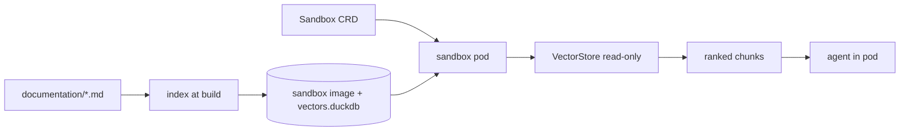

# Agent sandbox on Kubernetes guide

Deploy an agent that uses `duckdb-vectors` on
[Agent Sandbox](https://agent-sandbox.sigs.k8s.io/docs/), the Kubernetes-native
`Sandbox` CRD for isolated, stateful, singleton workloads. This is a deployment
guide: it sits alongside the [AWS Lambda guide](aws-lambda-guide.md) and the
[AWS Bedrock AgentCore guide](aws-bedrock-agentcore-guide.md), and targets the
Kubernetes community. The index ships inside the sandbox image and is opened
read-only in the pod — retrieval is in-process, with no external vector
service.

## When should I use Agent Sandbox?

Reach for Agent Sandbox when the agent is a long-running, stateful singleton
with a stable identity that belongs on a Kubernetes cluster you already
operate — the model AWS Lambda and AgentCore do not cover. Lambda is the
stateless single-turn shape; AgentCore is the managed AWS runtime; Agent
Sandbox is the self-hosted Kubernetes shape, with optional gVisor or Kata
isolation through a `RuntimeClass`.

## What you will build

A `Sandbox` pod whose image carries the `duckdb-vectors` package and a
pre-built `vectors.duckdb` index. The agent runs in the pod and calls the SDK
(or CLI) against the baked index, opened read-only. The index is frozen at
build time — no volume, no network for retrieval.



## Step 1 — bake the index into the sandbox image

Install `duckdb-vectors`, copy the documentation, and index it at build time so
the pod opens a frozen, read-only file. Pin the fastembed cache so the model
ships in the image and the pod needs no network for retrieval:

```dockerfile
FROM python:3.12-slim
ENV FASTEMBED_CACHE_PATH=/opt/fastembed_cache
RUN pip install --no-cache-dir duckdb-vectors
COPY documentation/ /app/documentation/
RUN duckdb-vectors index /app/documentation \
    --db /app/vectors.duckdb --backend fastembed:minishlab/potion-multilingual-128M
COPY agent.py /app/agent.py
ENV DUCKDB_VECTORS_DB_PATH=/app/vectors.duckdb
ENV DUCKDB_VECTORS_READ_ONLY=true
WORKDIR /app
```

Build and push the image to a registry your cluster can pull from:

```shell
$ docker build -t <registry>/duckdb-vectors-sandbox:latest .
$ docker push <registry>/duckdb-vectors-sandbox:latest
```

## Step 2 — call the SDK in the pod

Inside the pod the agent opens the baked index read-only and retrieves
in-process. The `DUCKDB_VECTORS_DB_PATH` set in the image means the CLI and SDK
resolve the index without an explicit path:

```python
from duckdb_vectors import VectorStore

store = VectorStore(
    db_path="/app/vectors.duckdb", backend="fastembed:minishlab/potion-multilingual-128M", read_only=True
)
hits = store.query("how is a search answered?", top_k=5)
for hit in hits:
    print(f"{hit.score:.4f}  {hit.chunk.source}  {hit.chunk.title}")
```

Each `hit` is a `SearchResult`: `hit.score` is the fused rank and `hit.chunk`
carries `source`, `title`, and `text`.

## Step 3 — declare the Sandbox

The `Sandbox` CRD manages a single stateful pod with a stable identity. Point
its pod template at the image you pushed:

```yaml
apiVersion: agents.x-k8s.io/v1beta1
kind: Sandbox
metadata:
  name: duckdb-vectors-agent
spec:
  podTemplate:
    spec:
      containers:
        - name: agent
          image: <registry>/duckdb-vectors-sandbox:latest
          command: ["python", "agent.py"]
```

Apply it to the cluster:

```shell
$ kubectl apply -f sandbox.yaml
```

For stronger isolation, add a `runtimeClassName` (gVisor or Kata) to the pod
spec, as the Agent Sandbox install guide describes.

## Verify the index in the pod

Confirm the baked index resolves read-only inside the running pod:

```shell
$ kubectl exec duckdb-vectors-agent -- duckdb-vectors report
```

The report prints the backend, dimensions, chunk count, and sources — proof the
frozen index is readable in the pod.

## The stdio-MCP alternative

Instead of importing the SDK directly, the agent can treat retrieval as an MCP
tool: it spawns `duckdb-vectors mcp` as a child process __inside the agent
container__ and talks to it over stdio. The server opens the same baked index
read-only, resolved from the `DUCKDB_VECTORS_*` environment variables, and
serves the `search` and `report` tools. See the
[Docker Agent guide](docker-agent-guide.md) for the canonical MCP wiring
reference.

Stdio is a same-container transport: an MCP client speaks to the server over
the child process's stdin/stdout, so the server must run in the __same
container__ as the agent, not a separate sidecar. Containers in a pod share a
network namespace but not a process tree or stdio, so a true sidecar split
would need a network transport (streamable-HTTP over `localhost`) — which this
server does not expose; it serves stdio only. Keep the MCP server in the agent
container, or use the in-process SDK call above.

## Where to go next

- The [AWS Lambda guide](aws-lambda-guide.md) covers the stateless single-turn
  shape on AWS.
- The [AWS Bedrock AgentCore guide](aws-bedrock-agentcore-guide.md) covers the
  managed AWS agent runtime.
- To build the frozen-index image this guide deploys, follow the
  [containerized agent guide](containerized-agent-guide.md).
