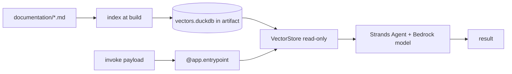

# AWS Bedrock AgentCore guide

A teach-by-example walk-through: build an agent that answers questions about
`duckdb-vectors`, bake the documentation index into it, and deploy it on Amazon
Bedrock AgentCore Runtime with the AgentCore CLI. It mirrors the
[Docker agent guide](docker-agent-guide.md) but targets the managed AgentCore
runtime instead of a plain container.

Verified against the AgentCore starter toolkit quickstart; command names and
flags can evolve, so cross-check the
[AgentCore documentation](https://docs.aws.amazon.com/bedrock-agentcore/latest/devguide/)
before a production deploy.

- [What you will build](#what)
- [Step 1 — install the toolkit](#install)
- [Step 2 — bake the index](#index)
- [Step 3 — the agent entrypoint](#entrypoint)
- [Step 4 — configure, deploy, invoke](#deploy)
- [Permissions](#permissions)
- [Follow-up](#follow-up)

## What you will build {#what}

An AgentCore Runtime agent whose answers are grounded in the `duckdb-vectors`
documentation. The index is embedded in the deployment artifact; at request
time the agent retrieves relevant chunks with `duckdb-vectors` and lets the
model (through Strands Agents) write the answer. `duckdb-vectors` does
retrieval; AgentCore runs the harness loop.



## Step 1 — install the toolkit {#install}

AgentCore needs Python 3.10+ and AWS credentials configured. Install the SDK,
Strands, and the starter toolkit:

```shell
$ pip install bedrock-agentcore strands-agents bedrock-agentcore-starter-toolkit
$ pip install duckdb-vectors[local]
$ agentcore --help
```

## Step 2 — bake the index {#index}

Index the documentation into a local DuckDB file that ships with the agent.
Use the `local` backend so retrieval is semantic and offline inside the
runtime:

```shell
$ duckdb-vectors index ./documentation --db vectors.duckdb --backend local
```

Keep `vectors.duckdb` next to the agent entrypoint so it is packaged with the
deployment.

## Step 3 — the agent entrypoint {#entrypoint}

AgentCore invokes a function decorated with `@app.entrypoint`. Open the index
read-only once at module load, retrieve per request, and hand the chunks to the
Strands agent as grounding:

```python
from bedrock_agentcore import BedrockAgentCoreApp
from strands import Agent

from duckdb_vectors import VectorStore

app = BedrockAgentCoreApp()
agent = Agent()
store = VectorStore(db_path="vectors.duckdb", backend="local", read_only=True)


@app.entrypoint
def invoke(payload):
    question = payload.get("prompt", "")
    hits = store.query(question, top_k=5)
    context = "\n\n".join(f"[{h.chunk.source}] {h.chunk.text}" for h in hits)
    result = agent(
        f"Answer using only this context:\n\n{context}\n\nQuestion: {question}"
    )
    return {"result": result.message}


if __name__ == "__main__":
    app.run()
```

List `duckdb-vectors[local]`, `bedrock-agentcore`, and `strands-agents` in the
agent's `requirements.txt`.

## Step 4 — configure, deploy, invoke {#deploy}

The toolkit creates the IAM execution role, builds the artifact (container via
CodeBuild, or direct code deploy), and hosts it in AgentCore Runtime:

```shell
$ agentcore configure -e my_agent.py       # creates .bedrock_agentcore.yaml
$ agentcore deploy                          # builds and deploys to AWS
$ agentcore invoke '{"prompt": "how is a search answered?"}'
```

`agentcore deploy` prints the agent ARN and the CloudWatch log location. Use
`agentcore status` to confirm resources are provisioned, and the AWS SDK
`invoke_agent_runtime` operation to call the agent programmatically.

## Permissions {#permissions}

`duckdb-vectors` reads a local file inside the runtime; it needs no AWS
permissions of its own for the index. Permissions come from the agent's
__execution role__, which the toolkit provisions:

- The Bedrock model calls (made by Strands) need `bedrock:InvokeModel` on the
  chosen model.
- If you use the `bedrock:titan` embedder at runtime instead of baking a local
  index, the execution role also needs `bedrock:InvokeModel` on the Titan embed
  model.

See the [AgentCore workbook](aws-bedrock-agentcore-workbook.md) for how the
execution context supplies these permissions.

## Follow-up {#follow-up}

- [aws-bedrock-agentcore-workbook.md](aws-bedrock-agentcore-workbook.md) — FAQ
- [docker-agent-guide.md](docker-agent-guide.md) — the plain-container version
- [AgentCore documentation](https://docs.aws.amazon.com/bedrock-agentcore/latest/devguide/)
