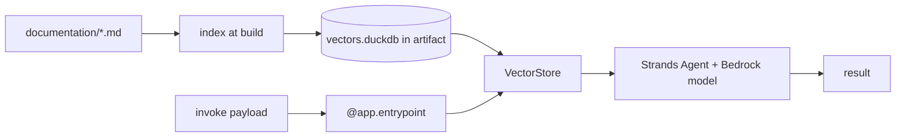

# AWS Bedrock AgentCore guide

A teach-by-example walk-through: build an agent that answers questions about [`duckdb-vectors`](https://pypi.org/project/duckdb-vectors/), bake the documentation index into it, and deploy it on Amazon Bedrock AgentCore Runtime with the AgentCore CLI. It mirrors the [containerized agent guide](containerized-agent-guide.md) but targets the managed AgentCore runtime instead of a plain container.

## Understand AgentCore deployment

[Amazon Bedrock AgentCore](https://docs.aws.amazon.com/bedrock-agentcore/latest/devguide/) is a managed runtime for AI agents: you supply an entrypoint, and the service runs the harness loop, provides the execution role, memory, and observability, and hosts the deployed artifact. `duckdb-vectors` fits inside that artifact as a local, read-only search index — retrieval runs in-process, and the only cloud calls are the model calls the agent makes to generate answers. This workbook answers the questions specific to that deployment: where the index lives, how permissions reach it, and when to embed locally versus in the cloud.

## How does this differ from a plain container?

The `duckdb-vectors` usage is identical — open read-only, `query`, feed the model. What differs is the harness and deployment: AgentCore provides the managed runtime, the entrypoint contract (`@app.entrypoint`), the execution role, memory options, and observability, and the toolkit builds and deploys the artifact for you. A plain container (see the [containerized agent guide](containerized-agent-guide.md)) gives you more control and runs anywhere, at the cost of operating the runtime yourself.

## What you will build

An AgentCore Runtime agent whose answers are grounded in the `duckdb-vectors` documentation. The index is embedded in the deployment artifact; at request time the agent retrieves relevant chunks with `duckdb-vectors` and lets the model (through Strands Agents) write the answer. `duckdb-vectors` does retrieval; AgentCore runs the harness loop.



## Step 1 — install the toolkit

AgentCore needs Python 3.10+ and AWS credentials configured. Install the SDK,
Strands, and the starter toolkit:

```shell
$ pip install bedrock-agentcore strands-agents bedrock-agentcore-starter-toolkit
$ pip install duckdb-vectors
$ agentcore --help
```

## Step 2 — bake the index

Index the documentation into a local DuckDB file that ships with the agent.
Use the `fastembed` backend so retrieval is semantic and offline inside the
runtime:

```shell
$ duckdb-vectors index ./documentation --db vectors.duckdb --backend fastembed:minishlab/potion-multilingual-128M
```

Keep `vectors.duckdb` next to the agent entrypoint so it is packaged with the
deployment.

## Step 3 — the agent entrypoint

AgentCore invokes a function decorated with `@app.entrypoint`. Open the index
read-only once at module load, retrieve per request, and hand the chunks to the
Strands agent as grounding:

```python
from bedrock_agentcore import BedrockAgentCoreApp
from strands import Agent

from duckdb_vectors import VectorStore

app = BedrockAgentCoreApp()
agent = Agent()
store = VectorStore(db_path="vectors.duckdb", backend="fastembed:minishlab/potion-multilingual-128M")


@app.entrypoint
def invoke(payload):
    question = payload.get("prompt", "")
    hits = store.query(question, top_k=5)
    context = "\n\n".join(f"[{h.chunk.source}] {h.chunk.text}" for h in hits)
    result = agent(
        f"Answer using only this context:\n\n{context}\n\nQuestion: {question}"
    )
    return {"result": result.message}


if __name__ == "__main__":
    app.run()
```

List `duckdb-vectors`, `bedrock-agentcore`, and `strands-agents` in the
agent's `requirements.txt`.

## Step 4 — configure, deploy, invoke

The toolkit creates the IAM execution role, builds the artifact (container via
CodeBuild, or direct code deploy), and hosts it in AgentCore Runtime:

```shell
$ agentcore configure -e my_agent.py       # creates .bedrock_agentcore.yaml
$ agentcore deploy                          # builds and deploys to AWS
$ agentcore invoke '{"prompt": "how is a search answered?"}'
```

`agentcore deploy` prints the agent ARN and the CloudWatch log location. Use `agentcore status` to confirm resources are provisioned, and the AWS SDK `invoke_agent_runtime` operation to call the agent programmatically.

## What permissions does duckdb-vectors need?

None of its own for reading the baked-in index — it reads a local file. All AWS permissions are __inherited from the execution context__ of the container that AgentCore runs: the agent's execution role, which the starter toolkit provisions during `agentcore configure` / `deploy`.

That means `duckdb-vectors` makes no assumption about credentials. When a part of the agent needs AWS access, it uses the ambient role:

- The model calls that generate answers need `bedrock:InvokeModel` on the model.
- If you embed at runtime with `bedrock:titan`, the embedder's boto3 client uses the same ambient role, which must   allow `bedrock:InvokeModel` on the Titan embed model. You can also pass an   explicit boto3 `session` to the embedder if you need different credentials.

This inherit-from-execution-context model is the same on any AWS compute (AgentCore, Lambda, ECS, EC2): grant the role, and `duckdb-vectors` picks up credentials through the default boto3 chain.
