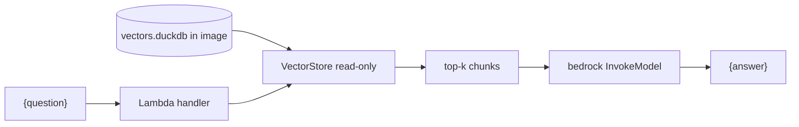

# AWS Lambda guide

A teach-by-example walk-through for the simplest useful shape: a Lambda
function that takes a question as input and returns a grounded answer as
output. No agentic loop — one retrieval, one Bedrock call, one response. This
is RAG reduced to a stateless function.

## When should I use Lambda instead of AgentCore? {#vs-agentcore}

Use Lambda when the interaction is a single turn: one question, one retrieval,
one model call, one answer — no multi-step tool use, no session memory. It is
the cheapest, simplest shape and scales to zero. Reach for
[AgentCore](aws-bedrock-agentcore-guide.md) when you need the agentic loop:
multi-turn sessions, tool orchestration, and managed memory.

## Understand the Lambda pattern {#overview}

[AWS Lambda](https://docs.aws.amazon.com/lambda/latest/dg/welcome.html) runs a
function in response to an event and scales to zero when idle. For
`duckdb-vectors` this is the simplest useful shape: a stateless function that
takes a question, retrieves grounding chunks from a baked-in index, makes one
direct Bedrock call to generate an answer, and returns it — no agentic loop, no
session. The index ships inside the function's container image and is opened
read-only. This workbook answers the practical questions of packaging and
operating that function.

## What you will build {#what}

A container-image Lambda whose `/invoke` takes `{"question": "..."}` and
returns `{"answer": "..."}`. The documentation index is baked into the image;
the handler retrieves chunks with `duckdb-vectors` and asks a Bedrock model to
answer from them.



## Step 1 — bake the index into the image {#index}

Lambda container images are read-only except for `/tmp`. Bake the index at
build time and open it read-only — no writable path needed:

```dockerfile
FROM public.ecr.aws/lambda/python:3.12
RUN pip install duckdb-vectors
COPY documentation/ ${LAMBDA_TASK_ROOT}/documentation/
RUN duckdb-vectors index ${LAMBDA_TASK_ROOT}/documentation \
    --db ${LAMBDA_TASK_ROOT}/vectors.duckdb --backend local
COPY handler.py ${LAMBDA_TASK_ROOT}/
CMD ["handler.lambda_handler"]
```

## Step 2 — the handler {#handler}

Open the store once at module load (reused across warm invocations), retrieve
per request, and make a single direct Bedrock call to generate the answer:

```python
import json

import boto3

from duckdb_vectors import VectorStore

store = VectorStore(
    db_path="vectors.duckdb", backend="local", read_only=True
)
bedrock = boto3.client("bedrock-runtime")
MODEL_ID = "anthropic.claude-3-5-sonnet-20240620-v1:0"


def lambda_handler(event, context):
    question = event.get("question", "")
    hits = store.query(question, top_k=5)
    grounding = "\n\n".join(f"[{h.chunk.source}] {h.chunk.text}" for h in hits)

    body = {
        "anthropic_version": "bedrock-2023-05-31",
        "max_tokens": 512,
        "messages": [
            {
                "role": "user",
                "content": (
                    f"Answer using only this context:\n\n{grounding}\n\n"
                    f"Question: {question}"
                ),
            }
        ],
    }
    response = bedrock.invoke_model(modelId=MODEL_ID, body=json.dumps(body))
    payload = json.loads(response["body"].read())
    answer = payload["content"][0]["text"]
    return {"answer": answer, "sources": [h.chunk.source for h in hits]}
```

The store is created at module scope so the index is opened once per execution
environment and reused across warm invocations. Trigger a warm-up query if you
use the `local` backend, so the first real request does not pay the one-time
model load.

## Step 3 — package and deploy {#deploy}

Build the image, push to ECR, and create the function from it:

```shell
$ docker build -t duckdb-vectors-lambda .
$ aws ecr create-repository --repository-name duckdb-vectors-lambda
$ # docker tag + push to the ECR repository URI, then:
$ aws lambda create-function \
    --function-name duckdb-vectors-rag \
    --package-type Image \
    --code ImageUri=<account>.dkr.ecr.<region>.amazonaws.com/duckdb-vectors-lambda:latest \
    --role arn:aws:iam::<account>:role/<lambda-execution-role> \
    --timeout 30 --memory-size 1024
```

## What permissions are required? {#permissions}

`duckdb-vectors` reads a local file and needs no AWS permissions. The function's execution role needs `bedrock:InvokeModel` on the answer model (and on the Titan embed model if you use it). Credentials come from the execution context via the default boto3 chain — the same inherit-from-the-role model used on AgentCore, ECS, and EC2.


## How do I keep cold starts low? {#cold-start}

- Open the `VectorStore` at module scope so it is created once per execution
  environment and reused across warm invocations.
- Keep `memory-size` generous enough — more memory also means more CPU, which
  speeds both the model load and the scan.
