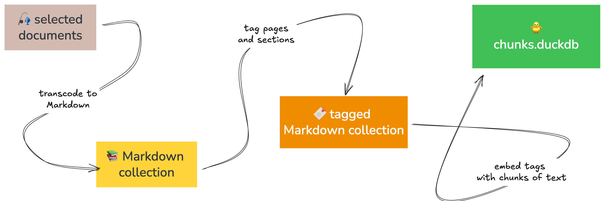

# Build the knowledge base

This procedure describes the successive steps for the creation of a relevant knowledge base for RAG. We start with one or multiple documents in various formats, and we deliver a single DuckDB file that is ready for semantic and keyword searches.

- [Understand the indexation process](#understand-the-indexation-process)
- [Step 1: gather relevant documents](#step-1-gather-relevant-documents)
- [Step 2: transcode documents to Markdown](#step-2-transcode-documents-to-markdown)
- [Step 3: tag Markdown pages and sections](#step-3-tag-markdown-pages-and-sections)
- [Step 4: prefix chunks with tags before embedding](#step-4-prefix-chunks-with-tags-before-embedding)
- [Step 5: check the knowledge base](#step-5-check-the-knowledge-base)

## Understand the indexation process

The diagram below illustrates the preparation of a DuckDB knowledge base.



Each of the steps illustrated above are described in following sections:

1. You start by selecting the reference documents that, together, constitute the explicit knowledge used by a specialized conversational agent.
2. While `duckdb-vectors` can ingest PDF files, it is better to transcode reference documents to the Markdown format. This format is efficient for chunking, and it accepts structured meta-data.
3. Tag the Markdown documents, adding meta-information that scope full pages, sections, or both.
4. For the creation of the DuckDB database, each page is split in meaningful chunks. Context is preserved by prefixing chunks with selected tags.
5. At the end of the process, you can control the content of the knowledge base and play with sample searches.

Let us dive a bit deeper into each of these steps.

## Step 1: gather relevant documents

Start by scoping a domain of expertise. Write down, in a few lines, what the agent has to answer about, for whom, and what it must not answer. This statement is your filter: a document that does not help answer these questions stays out. A small, focused corpus retrieves better than a large and loose one.

Then collect documents from two kinds of sources, and take from both:

- __External sources__ carry what the industry already agrees on: standards, regulations, vendor documentation, and well-known best practices.
- __Internal sources__ carry what your organization knows: curated know-how, opinionated ways of working, and standard operating procedures. They are often the most valuable, because nobody else has written them down.

Many formats can be considered. In the end you need a folder of files, and Markdown is the preferred format. You find it in git repositories, wikis, and documentation sites. In a corporate environment, office automation produces PDF files and editable documents such as Word, Excel, PowerPoint, or equivalents. Put everything in one folder tree, and keep a note of where each file comes from, so that you can refresh it later.

## Step 2: transcode documents to Markdown

`duckdb-vectors` ingests Markdown and PDF natively. The best scenario is still to transcode every file to Markdown. The challenge is to preserve the meaning and the structure of the source as much as possible, and more specifically:

- the text itself, assembled in consistent blocks
- the links, that can be used for the navigation of end-users
- the text attributes, to distinguish the nuances of bold and highlighted text
- the headers, that convey the document structure and that are used in semantic chunking
- the tables, that can be used as data sheets
- the diagrams, that can get a textual representation in mermaid format
- the pictures

End-users can consider three families of tools:

- __Converters.__ [markitdown](https://github.com/microsoft/markitdown) converts PDF, Word, Excel, PowerPoint, HTML and more to Markdown from the command line. [pandoc](https://pandoc.org/) is a good choice for Word and HTML.
- __Extraction services.__ For scanned or complex PDF files, an OCR or document-analysis service, such as Amazon Textract, recovers text and tables that a converter cannot read.
- __Agentic transformation.__ A language model reads the converted page, or a picture of it, and repairs what converters get wrong: it rebuilds a table, describes a picture, and redraws a diagram in mermaid. Use it where fidelity matters, and review a sample of the output.

For a first pass, `markitdown` runs on demand with `uvx`:

```shell
$ uvx "markitdown[all]" handbook.docx -o handbook.md
```

The [transcoding procedure](transcode-to-markdown-procedure) applies it to a folder of Word, PowerPoint and OpenDocument files, and lists what is lost on the way. The `transcode-to-markdown` skill runs the same procedure from a conversation with your agent, so that you can review the result on the spot. PDF files are indexed directly, so they need no conversion unless their structure matters to you.

## Step 3: tag Markdown pages and sections

Tags are meta-information written in the front matter of a Markdown page. They serve two purposes:

1. __Contextual retrieval.__ Chunking removes context, so a chunk can no longer say which product or which audience it belongs to. Tags restore it, as explained by Anthropic in [Contextual Retrieval](https://www.anthropic.com/news/contextual-retrieval). Page-level tags apply to every chunk of the page. Section-level tags, kept under the `sections` key, apply to the chunks of one section. In both cases the tags are put in front of the chunk before it is embedded.
2. __Regular SQL queries.__ The tags of a page are also stored with its chunks, so that a plain `SELECT` can filter on page attributes. For example, to list the chunks of the policy pages:

   ```sql
   SELECT source, title
   FROM chunks
   WHERE json_extract_string(metadata, '$.kind') = 'policy';
   ```

The curation toolbox uses a language model to write section contexts and page tags for you, once, offline, and it measures the result on your own questions:

```shell
$ make kb-context KB=pages
$ make kb-tags KB=pages
```

The [tagging procedure](tag-knowledge-base-procedure) is the sub-procedure for this step: it builds a validation set, writes the contexts and tags, and measures whether they help. The [tagged retrieval workbook](tagged-retrieval-workbook) answers the questions that come up when you choose and control tags.

## Step 4: prefix chunks with tags before embedding

Indexing builds the DuckDB file, and it updates it when you run it again. Only the chunks whose text or tags changed are embedded again.

```shell
$ duckdb-vectors index ./pages --recursive --db knowledge.duckdb
```

Two options control how tags reach the embeddings:

- `--tag-field "label: $.path"` declares one tag. The path is a JSONPath expression evaluated on the front matter of each page. Repeat the option for several tags. The order of the options is the order of the lines in the prefix.
- `--tag-bm25` also matches the tags in the exact-token search, so that a query that names a product finds chunks whose text never says it.

For example:

```shell
$ duckdb-vectors index ./pages --recursive --db knowledge.duckdb \
    --tag-field "product: $.product.name" \
    --tag-field "audience: $.audience[*]" \
    --tag-field "context: $.retrieval.context" \
    --tag-bm25
```

The path `$.audience[*]` takes every item of a list, and `$.retrieval.context` takes the section context written by the curation toolbox. The [tagged retrieval workbook](tagged-retrieval-workbook#which-jsonpath-expressions-work) lists the supported JSONPath expressions. Keep the prefix short: models cut input beyond their window, and a long prefix pushes the end of the chunk out of it.

## Step 5: check the knowledge base

The [inspection procedure](inspect-knowledge-base-procedure) is the sub-procedure for this step. It goes further than the commands below: it reviews the coverage and the values of each tag, and the prefix that was embedded.

Report on the content of the database: the number of chunks, the embedding backend, the declared tags, and the indexed sources.

```shell
$ duckdb-vectors report --db knowledge.duckdb
```

Then run sample searches, with questions that your users would really ask:

```shell
$ duckdb-vectors search "how do we roll back a release?" --db knowledge.duckdb --top-k 5
```

To find out which tags help and which only add noise, measure them against a file of real queries, one per line:

```shell
$ duckdb-vectors tags --db knowledge.duckdb \
    --tag-field "product: $.product.name" --queries my-queries.txt
```

Use the same `--backend` for `index`, `report` and `search`. If the sample searches return the wrong passages, change the tags or the transcoding, index again, and compare.

## Follow-up

- [Transcode office documents](transcode-to-markdown-procedure): convert Word and PowerPoint files to Markdown, step 2.
- [Tag a knowledge base](tag-knowledge-base-procedure): write section contexts and page tags offline, step 3.
- [Inspect a knowledge base](inspect-knowledge-base-procedure): review tags, their distribution, and search results, step 5.
- [Tagged retrieval workbook](tagged-retrieval-workbook): questions and answers on tags and the evidence behind them.
- [User guide](duckdb-vectors-guide): the indexing and search reference.
