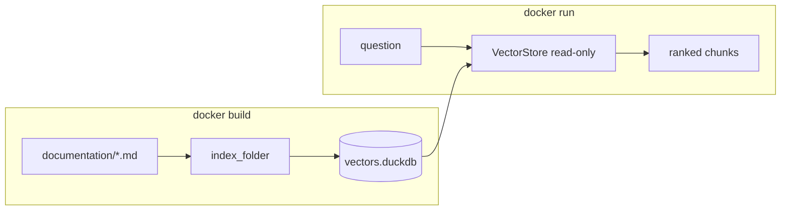

# Containerized agent guide

A teach-by-example walk-through: package a small agent in a container that
answers questions about `duckdb-vectors` itself. The agent indexes this very
`documentation/` folder at build time and serves answers from a frozen,
read-only index — the canonical build-then-freeze lifecycle.

The runnable assets live in [`examples/containerized-agent/`](https://github.com/bernard357/duckdb-vectors/tree/main/examples/containerized-agent):
`agent.py`, `requirements.txt`, and a `Dockerfile`.

## What you will build

A container that, given a question about `duckdb-vectors`, returns the most
relevant documentation chunks. The index is built once during
`docker build` and baked into the image; at run time the container opens it
read-only and answers in tens of milliseconds, with no external service.



## Step 1 — the agent code

The agent is one small module. It has a build-time path that indexes a folder,
and a query-time path that opens the index read-only and retrieves chunks. It
uses the `local` backend (fastembed ONNX) — the minimum viable setup for real
relevance, which runs fully offline once the model is baked into the image.
Switch to `bedrock:titan` for cloud embedding, and pass the retrieved chunks to
an LLM to generate prose answers.

```python
from duckdb_vectors import VectorStore, index_folder

BACKEND = "local"


def build_index(docs: str, db_path: str) -> None:
    store = VectorStore(db_path=db_path, backend=BACKEND)
    try:
        index_folder(store, docs, recursive=True)
    finally:
        store.close()


def answer(question: str, db_path: str, top_k: int = 5):
    store = VectorStore(db_path=db_path, backend=BACKEND, read_only=True)
    try:
        return store.query(question, top_k=top_k)
    finally:
        store.close()
```

See [`examples/containerized-agent/agent.py`](https://github.com/bernard357/duckdb-vectors/blob/main/examples/containerized-agent/agent.py) for
the full module with a small CLI.

## Step 2 — index the documentation

Point the agent at the documentation folder to build the index:

```shell
$ python examples/containerized-agent/agent.py --index ./documentation --db vectors.duckdb
indexed 12 files, 94 chunks (94 embedded)
```

The counts reflect this repository's documentation at the time of writing;
yours will differ as pages are added. The first run downloads the fastembed
model; later runs reuse the cached model.

## Step 3 — ask a question locally

```shell
$ python examples/containerized-agent/agent.py --db vectors.duckdb "how is a search answered?"
0.0320  duckdb-vectors-primitive.md  1. The query string is embedded once ...
0.0315  duckdb-workbook.md           Opening read-only is the serving mode ...
...
```

The top hit is the primitive's "how a search is answered" section — the
retrieval is working. A full agent would feed these chunks to an LLM and return
a written answer; the retrieval step is what `duckdb-vectors` provides.

## Step 4 — the two-stage Dockerfile

The build stage installs the `local` backend, downloads its model, copies the
documentation, and indexes it. The runtime stage copies only the agent, the
frozen index, and the model cache, so the serving image carries no build
tooling and needs no network. The fastembed cache path is pinned so it can be
copied between stages.

```dockerfile
FROM python:3.12-slim AS builder
WORKDIR /build
ENV FASTEMBED_CACHE_PATH=/opt/fastembed_cache
COPY examples/containerized-agent/requirements.txt .
RUN pip install --no-cache-dir -r requirements.txt
COPY examples/containerized-agent/agent.py .
COPY documentation/ ./documentation/
RUN python agent.py --index ./documentation --db /build/vectors.duckdb

FROM python:3.12-slim AS runtime
WORKDIR /app
ENV FASTEMBED_CACHE_PATH=/opt/fastembed_cache
COPY examples/containerized-agent/requirements.txt .
RUN pip install --no-cache-dir -r requirements.txt
COPY examples/containerized-agent/agent.py .
COPY --from=builder /build/vectors.duckdb /app/vectors.duckdb
COPY --from=builder /opt/fastembed_cache /opt/fastembed_cache
ENV DUCKDB_VECTORS_DB_PATH=/app/vectors.duckdb
ENV DUCKDB_VECTORS_READ_ONLY=true
ENTRYPOINT ["python", "agent.py", "--db", "/app/vectors.duckdb"]
CMD ["what is duckdb-vectors?"]
```

See [`examples/containerized-agent/Dockerfile`](https://github.com/bernard357/duckdb-vectors/blob/main/examples/containerized-agent/Dockerfile).

## Step 5 — build and run the container

Build from the repository root (the build context must include both
`examples/containerized-agent/` and `documentation/`):

```shell
$ docker build -f examples/containerized-agent/Dockerfile -t duckdb-vectors-agent .
$ docker run --rm duckdb-vectors-agent "how is a search answered?"
```

The frozen index is inside the image, so the container needs no volume and no
network to answer.
