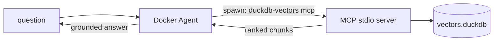

# Docker Agent guide

Wire an agent running on [Docker Agent](https://docs.docker.com/ai/docker-agent/) to [`duckdb-vectors`](https://pypi.org/project/duckdb-vectors/) through the Model Context Protocol (MCP). Docker Agent spawns `duckdb-vectors mcp` as a local subprocess and calls its `search` tool over stdio — no bespoke glue, no external vector service.

This is the __integrate into an existing agent runtime__ path. It is complementary to the [containerized agent guide](containerized-agent-guide.md), which bakes a self-contained image that embeds both the retrieval code and a frozen index. Here, Docker Agent owns the agent loop and the model, and `duckdb-vectors` plugs in as one retrieval tool.

## What is Docker Agent?

Docker Agent (the `cagent` multi-agent runtime) runs agents defined in a YAML file: an agent references a model and a set of __toolsets__. One toolset type is `mcp` — it connects the agent to any MCP server. The __local-stdio__ flavour runs the server as a subprocess identified by a `command` and `args`, and talks to it over stdin/stdout. That is exactly how an MCP client is meant to spawn `duckdb-vectors mcp`.



## The tools exposed

`duckdb-vectors mcp` registers two read-only tools:

- `search(query, top_k=5)` — hybrid semantic + exact-token search; returns the ranked chunks (`chunk_id`, `text`, `source`, `title`, `score`).
- `report()` — introspects the index: database path, backend, dimensions, chunk count, and sources.

Both open the index resolved from the `DUCKDB_VECTORS_*` environment variables and only query it — the tools never write, matching the baked-index serving lifecycle.

## The Docker Agent configuration

The local-stdio `mcp` toolset accepts `command`, `args`, `tools`, `env`, and `working_dir` (verified against the [Docker Agent MCP tool reference](https://docs.docker.com/ai/docker-agent/tools/mcp/)). Point `command` at `duckdb-vectors`, pass `mcp` as the argument, and set the index location through `env`:

```yaml
version: "15"

models:
  claude:
    provider: anthropic
    model: claude-sonnet-4-6

agents:
  root:
    model: claude
    description: Answers questions about duckdb-vectors from a baked index.
    instruction: |
      You answer questions about duckdb-vectors.
      Always call the `search` tool to retrieve relevant documentation chunks
      before answering, and ground your answer in the returned text. Use the
      `report` tool when asked what the index contains.
    toolsets:
      - type: mcp
        command: duckdb-vectors
        args: ["mcp"]
        tools: ["search", "report"]
        env:
          DUCKDB_VECTORS_DB_PATH: ${env.DUCKDB_VECTORS_DB_PATH}
```

The runnable config and a companion README live in [`examples/docker-agent/`](https://github.com/bernard357/duckdb-vectors/blob/main/examples/docker-agent/agent.yaml).

## Step 1 — install duckdb-vectors

The `mcp` verb ships in the base package — no extra to remember:

```shell
$ pip install duckdb-vectors
```

## Step 2 — build an index

Point the CLI at a folder of markdown to produce a single DuckDB file. Here we index this project's own documentation:

```shell
$ duckdb-vectors index ./documentation --db vectors.duckdb
Indexed 13 files, 98 chunks (98 embedded, 0 reused, 0 pruned).
```

The counts reflect this repository at the time of writing; yours will differ. The first run downloads the fastembed model; later runs reuse the cache.

## Step 3 — point the YAML at the index

Docker Agent reads the index path from the environment variable referenced in the config. Export it to the absolute path of the file you just built:

```shell
$ export DUCKDB_VECTORS_DB_PATH="$PWD/vectors.duckdb"
```

## Step 4 — run the agent and ask a question

```shell
$ docker agent run examples/docker-agent/agent.yaml "how is a search answered?"
```

Docker Agent spawns `duckdb-vectors mcp`, the agent calls the `search` tool, and the model grounds its answer in the returned chunks. Ask what the index holds to exercise the `report` tool:

```shell
$ docker agent run examples/docker-agent/agent.yaml "what does the index contain?"
```

## Verify the server on its own

You can confirm the server starts and registers its tools without a client:

```shell
$ duckdb-vectors mcp --help
```

A full session needs an MCP client to drive the stdio handshake; Docker Agent is that client.

## Where to go next

- To ship a self-contained image that carries both the agent and a frozen index, follow the [containerized agent guide](containerized-agent-guide.md).
- The same `duckdb-vectors mcp` command works with any MCP client — Claude Desktop, Claude Code, and Cursor all spawn local-stdio servers the same way.
