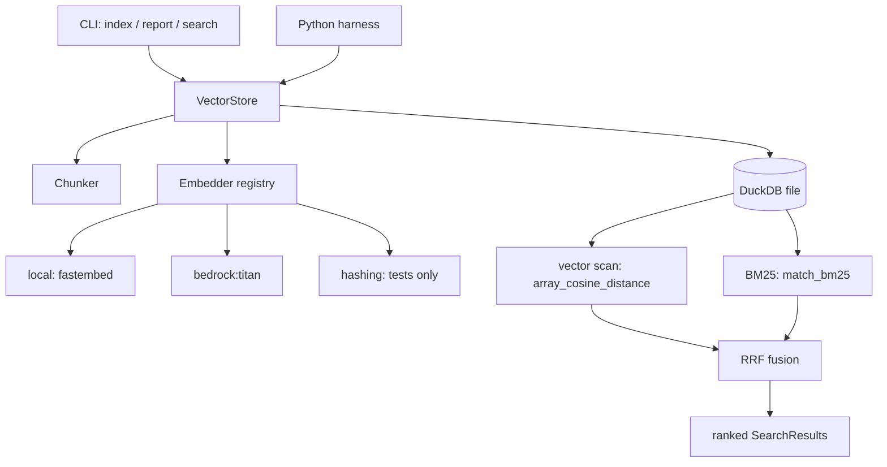

# duckdb-vectors primitive

This page explains how `duckdb-vectors` is built: the architecture, the
building blocks it exposes, and the two surfaces you drive it through — the
Python API and the command-line interface. Read it to understand what the
component is before the [guide](duckdb-vectors-guide.md) walks you through
using it.

- [Understand the primitive](#overview)
- [Building blocks](#building-blocks)
- [The data model](#data-model)
- [The API surface](#api-surface)
- [The CLI surface](#cli-surface)
- [How a search is answered](#search-flow)
- [Lifecycles](#lifecycles)
- [Follow-up](#follow-up)

## Understand the primitive {#overview}

`duckdb-vectors` is a small retrieval building block. One DuckDB file is one
index. You put chunks of text (with metadata) into it, and you query it with a
natural-language string; it answers with ranked chunks in tens of
milliseconds. It does retrieval only — storing, indexing, searching — and
leaves generation and orchestration to the harness around it.

The whole component is a thin, deliberate layer over DuckDB:



## Building blocks {#building-blocks}

Each block is small and replaceable. You can use the defaults or swap any one.

- __VectorStore__ — the public API. One instance maps to one DuckDB file. It
  owns the schema, the write path (`put_vectors`, `add_texts`,
  `delete_vectors`), and the read path (`query`, `query_vectors`). Open it
  read-write to build an index, or read-only to serve a frozen one.
- __Embedder registry__ — turns a backend string into an embedder. `local`
  (fastembed) is the default and the minimum viable setup for users;
  `bedrock:titan` embeds in the cloud; `hashing` is a deterministic,
  dependency-free fixture for tests and CI, not for relevance. Contributors add
  more with `register_embedder(name, factory)` without touching the core.
- __Chunker__ — splits a source document into indexable chunks. The default
  `MarkdownChunker` uses the DuckDB `markdown` extension to split on headings.
  Supply any object with a `chunk(text, source)` method to replace it.
- __Indexer__ — `index_folder` walks a folder of markdown, chunks each file,
  and embeds only the chunks whose content changed since the last run (ETag
  reuse), then prunes chunks for files that disappeared.
- __CLI__ — a thin wrapper over the store and indexer: `index`, `report`,
  `search`.

## The data model {#data-model}

The store keeps one table, `chunks`, with a fixed-size embedding column:

| Column | Meaning |
| --- | --- |
| `chunk_id` | Stable key; re-indexing the same position upserts it |
| `text` | The chunk text, embedded and full-text indexed |
| `source` | Document identifier (typically a relative path) |
| `position` | Ordinal of the chunk within its source |
| `title` | Heading breadcrumb, prepended context |
| `metadata` | JSON blob for arbitrary attributes |
| `etag` | Content fingerprint; unchanged etag skips re-embedding |
| `stamped_at` | Run timestamp; older stamps are pruned on reindex |
| `embedding` | `FLOAT[dim]` ARRAY column (HNSW-ready) |

The `Chunk` and `SearchResult` models are Pydantic classes; a `SearchResult`
carries the chunk, the fused score, and the per-signal ranks (`vector_rank`,
`text_rank`).

## The API surface {#api-surface}

The S3-Vectors-flavored write and read methods:

```python
from duckdb_vectors import VectorStore

store = VectorStore(db_path="vectors.duckdb", backend="local")

# Chunk-first convenience: upsert raw texts.
store.add_texts(
    ids=["doc:0", "doc:1"],
    texts=["an in-process analytical database", "vectors capture similarity"],
    metadatas=[{"kind": "intro"}, {"kind": "intro"}],
)

# Hybrid search (vector + exact-token BM25, fused with RRF).
for hit in store.query("embedded database", top_k=3):
    print(hit.score, hit.chunk.chunk_id, hit.chunk.text)

# Pure vector search with a precomputed embedding.
vector = store.embedder.embed(["embedded database"])[0]
hits = store.query_vectors(vector, top_k=3)

# Read-side helpers.
store.get_vectors(["doc:0"])
store.list_vectors(limit=10)
store.count()

# Write-side helpers.
store.delete_vectors(["doc:1"])
store.close()
```

For metadata scoping and age decay through an injected `SELECT`, see the
[developer guide](duckdb-vectors-guide.md#search) and the README section on
injectable ranking SQL.

## The CLI surface {#cli-surface}

The CLI covers the three operational verbs and honors the same configuration
(constructor argument > `DUCKDB_VECTORS_*` env > default):

```shell
$ duckdb-vectors index ./docs --backend local      # index a folder
$ duckdb-vectors report --json                      # stats on the database
$ duckdb-vectors search "how do retries work?" --top-k 5
```

Common options: `--db` (file path), `--backend` (embedder spec), `--top-k`,
`--recursive` (on `index`), and `--json` (machine-readable output).

## How a search is answered {#search-flow}

1. The query string is embedded once with the configured backend.
2. A vector ranking is produced by `array_cosine_distance` over the embedding
   column.
3. A lexical ranking is produced by exact-token BM25 (`match_bm25`).
4. The two rankings are fused with Reciprocal Rank Fusion into one ordered
   list, each result carrying its component ranks.

Set `hybrid=False` on `query` for vector-only ranking. The lexical signal is
deliberately an exact-token match (no stemming) so acronyms and codes are
found without a language dependency; see the README design note.

## Lifecycles {#lifecycles}

- __Build-then-freeze__ — build the index at image-build time, open it
  read-only at runtime. The container answers from a baked-in file with no
  external service. See the [Docker guide](docker-agent-guide.md).
- __Runtime append__ — open the store read-write at harness init and append a
  registry (for example a set of tools or skills), then search it. See
  [setup-skills-search-procedure.md](setup-skills-search-procedure.md).

## Follow-up {#follow-up}

- [duckdb-vectors-guide.md](duckdb-vectors-guide.md) — the hand-held workflow
- [duckdb-workbook.md](duckdb-workbook.md) — DuckDB patterns this builds on
- [setup-rag-procedure.md](setup-rag-procedure.md) — build an answering machine
- [README](../README.md) — install, quickstart, configuration, alternatives
