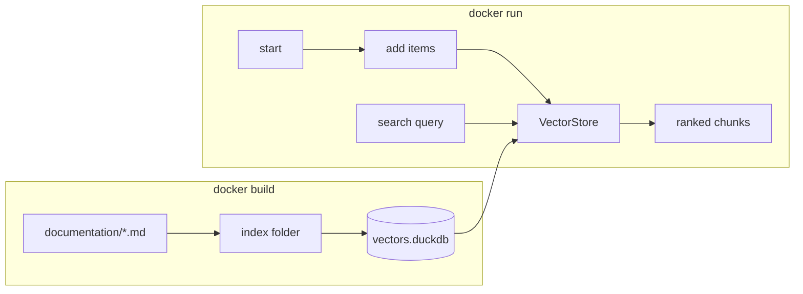
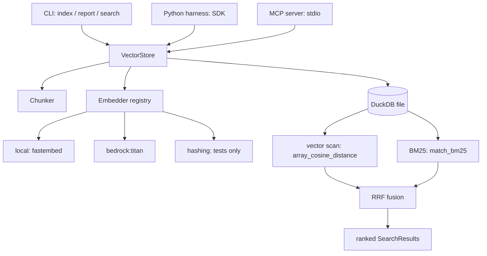

# Technical design

This page explains how `duckdb-vectors` is built: the architecture, the
building blocks it exposes, and the three surfaces you drive it through — the
Python SDK, the command-line interface, and an MCP server for agents.

## Understand container lifecycle

A baked-in index makes the container self-contained: no external vector database, no network dependency at query time, and a reproducible artifact that is identical in every environment. The build-then-freeze lifecycle opens the file read-only at run time, which needs no experimental persistence flags because the default ranking is a plain cosine scan.

You can also expand the database during the execution of the container. Open the store read-write at startup and append a registry (for example a set of tools or skills), then search it. A writable DuckDB file is single-writer, so keep writes to one process. For a read-only frozen index, open with `read_only=True`, which also refuses accidental writes. 

Given a search query, the container returns the most
relevant chunks of text. 



The solution supports static and dynamic indexing:

- __Build-then-freeze__ — build the index at image-build time, open it
  read-only at runtime. The container answers from a baked-in file with no
  external service. See the example [Setup a RAG agent](setup-rag-procedure.md).
- __Runtime append__ — open the store read-write at harness init and append a
  registry (for example a set of tools or skills), then search it. See
  the example [Search over skills](setup-skills-search-procedure.md).

## Understand the architecture

`duckdb-vectors` is a small retrieval building block. One DuckDB file is one
index. You put chunks of text (with metadata) into it, and you query it with a
natural-language string; it answers with ranked chunks in tens of
milliseconds. It does retrieval only — storing, indexing, searching — and
leaves generation and orchestration to the harness around it.

The whole component is a thin, deliberate layer over DuckDB:



## Building blocks

Each block is small and replaceable. You can use the defaults or swap any one.

- __VectorStore__ — the SDK surface. One instance maps to one DuckDB file. It
  owns the schema, the write path (`put_vectors`, `add_texts`,
  `delete_vectors`), and the read path (`query`, `query_vectors`). Open it
  read-write to build an index, or read-only to serve a frozen one.
- __Embedder registry__ — turns a backend string into an embedder. `local`
  (fastembed) is the default and the minimum viable setup for users;
  `bedrock:titan` embeds in the cloud; `hashing` is a deterministic,
  dependency-free fixture for tests and CI, not for relevance. Contributors add
  more with `register_embedder(name, factory)` without touching the core.
- __Chunker__ — splits a source document into indexable chunks. The default
  `MarkdownChunker` uses the DuckDB `markdown` extension to split on headings.
  Supply any object with a `chunk(text, source)` method to replace it.
- __Indexer__ — `index_folder` walks a folder of markdown, chunks each file,
  and embeds only the chunks whose content changed since the last run (ETag
  reuse), then prunes chunks for files that disappeared.
- __CLI__ — a thin wrapper over the store and indexer: `index`, `report`,
  `search`, and `mcp` (serve retrieval over stdio to an agent).

## The data model

The store keeps one table, `chunks`, with a fixed-size embedding column:

| Column | Meaning |
| --- | --- |
| `chunk_id` | Stable key; re-indexing the same position upserts it |
| `text` | The chunk text, embedded and full-text indexed |
| `source` | Document identifier (typically a relative path) |
| `position` | Ordinal of the chunk within its source |
| `title` | Heading breadcrumb, prepended context |
| `metadata` | JSON blob for arbitrary attributes |
| `etag` | Content fingerprint; unchanged etag skips re-embedding |
| `stamped_at` | Run timestamp; older stamps are pruned on reindex |
| `embedding` | `FLOAT[dim]` ARRAY column (HNSW-ready) |

The `Chunk` and `SearchResult` models are Pydantic classes; a `SearchResult` carries the chunk, the fused score, and the per-signal ranks (`vector_rank`, `text_rank`).

## The SDK surface

The Python library (SDK) exposes the S3-Vectors-flavored write and read methods. Import `VectorStore` and drive it in-process:

```python
from duckdb_vectors import VectorStore

store = VectorStore(db_path="vectors.duckdb", backend="local")

# Chunk-first convenience: upsert raw texts.
store.add_texts(
    ids=["doc:0", "doc:1"],
    texts=["an in-process analytical database", "vectors capture similarity"],
    metadatas=[{"kind": "intro"}, {"kind": "intro"}],
)

# Hybrid search (vector + exact-token BM25, fused with RRF).
for hit in store.query("embedded database", top_k=3):
    print(hit.score, hit.chunk.chunk_id, hit.chunk.text)

# Pure vector search with a precomputed embedding.
vector = store.embedder.embed(["embedded database"])[0]
hits = store.query_vectors(vector, top_k=3)

# Read-side helpers.
store.get_vectors(["doc:0"])
store.list_vectors(limit=10)
store.count()

# Write-side helpers.
store.delete_vectors(["doc:1"])
store.close()
```

For metadata scoping and age decay through an injected `SELECT`, see the [developer guide](duckdb-vectors-guide.md#how-to-search-for-matching-content) and the README section on injectable ranking SQL.

## The CLI surface

The CLI covers the three operational verbs and honors the same configuration (constructor argument > `DUCKDB_VECTORS_*` env > default):

```shell
$ duckdb-vectors index ./docs --backend local      # index a folder
$ duckdb-vectors report --json                      # stats on the database
$ duckdb-vectors search "how do retries work?" --top-k 5
```

Common options: `--db` (file path), `--backend` (embedder spec), `--top-k`,
`--recursive` (on `index`), and `--json` (machine-readable output).

## The MCP surface

The third surface turns retrieval into a tool an agent can call over the
[Model Context Protocol](https://modelcontextprotocol.io). `duckdb-vectors mcp`
starts a Model Context Protocol server over stdio: it reads JSON-RPC from
stdin and writes to stdout, so any MCP client — Docker Agent, Claude Desktop,
Claude Code, Cursor — spawns it as a local subprocess and talks to it
in-process, with no network and no port. It is the same read-only serving path
as the SDK and CLI, exposed as callable tools.

```shell
$ duckdb-vectors mcp                       # serve over stdio (reads a baked index)
```

The server exposes two read-only tools, backed by a read-only `VectorStore`
resolved from the usual configuration (`--db` / `--backend` or the
`DUCKDB_VECTORS_*` environment variables):

| Tool | Does |
| --- | --- |
| `search` | Hybrid search for a query string; returns ranked chunks |
| `report` | Read-only introspection: database path, backend, dimensions, chunk count, sources |

A client wires it in by command, not by discovery. For example, a Docker Agent
`mcp` toolset points at the command directly:

```yaml
toolsets:
  - type: mcp
    command: duckdb-vectors
    args: ["mcp"]
    env:
      DUCKDB_VECTORS_DB_PATH: /app/vectors.duckdb
      DUCKDB_VECTORS_READ_ONLY: "true"
```

See the [Docker Agent guide](docker-agent-guide.md) for a complete, runnable
integration. Transport is stdio today, which fits the co-located
subprocess model; a networked (HTTP) transport is a possible future addition
for cross-container use.

## How a search is answered

1. The query string is embedded once with the configured backend.
2. A vector ranking is produced by `array_cosine_distance` over the embedding
   column.
3. A lexical ranking is produced by exact-token BM25 (`match_bm25`).
4. The two rankings are fused with Reciprocal Rank Fusion into one ordered
   list, each result carrying its component ranks.

Set `hybrid=False` on `query` for vector-only ranking. The lexical signal is  deliberately an exact-token match (no stemming) so acronyms and codes are found without a language dependency; see the README design note.

## What about cold start and latency?

Total query latency is the query embedding plus the ranking scan. The scan over a few-to-tens-of-thousands of 384-dim chunks is single-digit to low-tens of milliseconds. With `local` embedding, the one-time model load happens on first use — trigger a warm-up query at startup so the first real request is not the one that pays for it. When using a remote embedding service, e.g., `bedrock`, then this adds a network round-trip per embed.

## How do I keep the image small?

- The DuckDB file itself is compact — a few thousand 384-dim chunks is a small
  number of megabytes.
- Use a two-stage build: install and index in the builder stage, copy only the
  agent code and the frozen `.duckdb` into the runtime stage.
- Prefer `python:3.12-slim` as the base.
