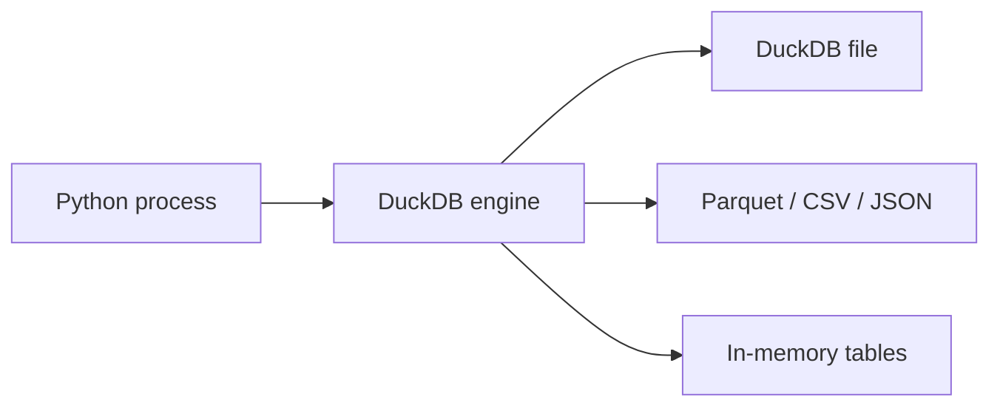

# DuckDB workbook

A Q&A reference for the DuckDB patterns `duckdb-vectors` relies on. It explains
the engine underneath the component so you can reason about performance,
extend the ranking SQL, or query the index directly.

This page is adapted from the DuckDB workbook of the Hermione project, with
project-specific material (DuckLake, DynamoDB bridges, Lambda-bundle
constraints, S3 ETag staging) removed and the content refocused on embedded
vector search.

- [Understand DuckDB](#overview)
- [Glossary](#glossary)
- [How to query data?](#querying)
- [How to parse Markdown with DuckDB?](#markdown)
- [How to perform vector search?](#vector-search)
- [How to add an exact-token BM25 index?](#bm25)
- [How to open a read-only database?](#read-only)
- [How to troubleshoot DuckDB issues?](#troubleshooting)
- [Follow-up](#follow-up)

## Understand DuckDB {#overview}

[DuckDB](https://duckdb.org) is an in-process analytical database for fast SQL
on local data. Created in 2018 at CWI Amsterdam, it is often described as
"SQLite for analytics" — embedded, zero-configuration, columnar.

It runs inside the host process, so there is no network hop and no server to
operate. That property is exactly why it fits an embeddable, read-mostly vector
index baked into a container image.



## Glossary {#glossary}

- DuckDB — in-process analytical database engine; runs inside the Python
  process
- ARRAY — fixed-size list column type; `FLOAT[384]` holds a 384-dim embedding
- VSS — the vector similarity search extension (HNSW indexing); optional here
- FTS — the full-text search extension providing BM25 scoring
- markdown extension — community extension that parses markdown into SQL rows

## How to query data? {#querying}

DuckDB runs standard SQL and can read files directly, without a load step.

```python
import duckdb

con = duckdb.connect("vectors.duckdb")

# Count chunks per source.
rows = con.execute("""
    SELECT source, COUNT(*) AS n
    FROM chunks
    GROUP BY source
    ORDER BY n DESC
""").fetchall()

# Parameterized lookup.
row = con.execute(
    "SELECT text FROM chunks WHERE chunk_id = ?", ["docs/intro.md:0"]
).fetchone()
```

A `duckdb-vectors` database is an ordinary DuckDB file: you can open it with
the `duckdb` CLI or the Python client and inspect the `chunks` table directly.

## How to parse Markdown with DuckDB? {#markdown}

The [markdown](https://github.com/teaguesterling/duckdb_markdown) community
extension parses markdown into structured rows. `duckdb-vectors` uses it inside
`MarkdownChunker` to split documents on headings.

```python
import duckdb

con = duckdb.connect()
con.execute("INSTALL markdown FROM community")
con.execute("LOAD markdown")

sections = con.execute(
    """
    SELECT section_id, section_path, level, title,
           md_to_text(content) AS text
    FROM read_markdown_sections('path/to/doc.md')
    WHERE level BETWEEN 1 AND 3
      AND length(md_to_text(content)) >= 1
    ORDER BY start_line
    """
).fetchall()
```

`read_markdown_sections` returns one row per heading-scoped section with its
breadcrumb (`section_path`), level, title, and content. `md_to_text` strips
markdown formatting to plain text — the string that gets embedded. The
`content_mode` option controls nesting: `minimal` stops at the next heading,
`full` includes subsections, `smart` adapts to length.

## How to perform vector search? {#vector-search}

Store embeddings in a fixed-size `FLOAT[dim]` ARRAY column and rank by
`array_cosine_distance`. At the few-to-tens-of-thousands-of-chunks scale this
component targets, a brute-force scan answers in single-digit to low tens of
milliseconds — no index required.

```sql
SELECT chunk_id
FROM chunks
ORDER BY array_cosine_distance(embedding, $query::FLOAT[384])
LIMIT 10;
```

The embedding dimension is fixed when the table is created (384 for the local
fastembed default, 1024 for Bedrock Titan v2). DuckDB also offers
`array_inner_product` and `array_distance` (Euclidean) if you prefer a
different metric in a custom ranking SELECT.

The schema is HNSW-ready: when a corpus outgrows brute force, the
[VSS extension](https://duckdb.org/docs/stable/core_extensions/vss) can build
an HNSW index on the same ARRAY column. Note that persisting an HNSW index to a
file still requires the experimental persistence flag, which is why the default
path stays brute-force and trivially read-only.

## How to add an exact-token BM25 index? {#bm25}

The [FTS extension](https://duckdb.org/docs/stable/core_extensions/full_text_search)
provides BM25 scoring via `match_bm25`, backed by an index built with
`PRAGMA create_fts_index`. `duckdb-vectors` builds it with no stemming and no
stopwords, so matching is literal — strong on acronyms, codes, and
single-keyword queries, and free of any language tie.

```sql
PRAGMA create_fts_index(
    'chunks', 'chunk_id', 'text', 'title',
    stemmer = 'none', stopwords = 'none', overwrite = 1
);

SELECT chunk_id, fts_main_chunks.match_bm25(chunk_id, 'ESRS') AS score
FROM chunks
WHERE score IS NOT NULL
ORDER BY score DESC;
```

With stemming off, `run` does not match `running`; only the exact token does.
The index lives in the `fts_main_chunks` schema created by the pragma.

## How to open a read-only database? {#read-only}

Opening read-only is the serving mode: a frozen index baked into an image, read
by many requests, never written.

```python
import duckdb

con = duckdb.connect("vectors.duckdb", read_only=True)
```

Because the default ranking is a plain `array_cosine_distance` scan with no
persisted vector index, read-only open needs no experimental flags. In
`duckdb-vectors` this is `VectorStore(..., read_only=True)`, which also refuses
writes with a clear error.

## How to troubleshoot DuckDB issues? {#troubleshooting}

Out of memory — raise the limit or spill to disk:

```python
con.execute("SET memory_limit = '4GB'")
con.execute("SET temp_directory = '/tmp/duckdb'")
```

Profile a slow query:

```python
con.execute("PRAGMA enable_profiling")
con.execute("SELECT ...")
```

Type mismatch on the embedding cast — the ARRAY dimension must match the column
exactly (`$v::FLOAT[384]` for a 384-dim column); a wrong dimension raises a bind
error. Keep the embedder's `dimensions` and the table dimension in sync; the
store does this for you.

## Follow-up {#follow-up}

- [DuckDB documentation](https://duckdb.org/docs/)
- [DuckDB Python API](https://duckdb.org/docs/stable/clients/python/overview)
- [VSS extension](https://duckdb.org/docs/stable/core_extensions/vss)
- [FTS extension](https://duckdb.org/docs/stable/core_extensions/full_text_search)
- [markdown extension](https://github.com/teaguesterling/duckdb_markdown)
- [duckdb-vectors-primitive.md](duckdb-vectors-primitive.md) — how the component uses these patterns
