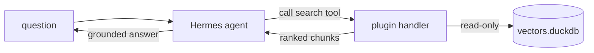

# Hermes guide

Wire the [Hermes agent framework](https://github.com/NousResearch/hermes-agent)
to `duckdb-vectors` as a retrieval tool. Hermes loads plugins that register
tools; the plugin here registers a `search` tool whose handler opens a local,
read-only index and returns ranked chunks. The primary path imports the SDK in
the plugin handler; the alternative wires the stdio MCP server through Hermes'
native MCP client.

## What you will build {#what}

A Hermes plugin that registers a `search` tool. The plugin's `register(ctx)`
function wires a JSON schema (what the model sees) to a handler that calls
`store.query`. The index is a local DuckDB file opened read-only.



## Step 1 — install the pieces {#install}

Install Hermes and `duckdb-vectors` into the same environment so the plugin
handler can import the SDK:

```shell
$ pip install hermes-agent duckdb-vectors
```

## Step 2 — build an index {#index}

Point the CLI at a folder of markdown to produce a single DuckDB file:

```shell
$ duckdb-vectors index ./documentation --db vectors.duckdb --backend local
```

The first run downloads the fastembed model; later runs reuse the cache.

## Step 3 — the plugin {#plugin}

A Hermes plugin is a directory under `~/.hermes/plugins/` with a `plugin.yaml`
manifest and an `__init__.py` exposing `register(ctx)`. The manifest names the
plugin:

```yaml
name: duckdb-vectors
version: "1.0"
description: Retrieval over a local duckdb-vectors index.
```

The `register(ctx)` function declares the tool schema and wires it to a handler
that calls `store.query`. Open the store once at import and reuse it:

```python
"""Hermes plugin — registers a duckdb-vectors search tool."""

import json

from duckdb_vectors import VectorStore

store = VectorStore(
    db_path="vectors.duckdb", backend="local", read_only=True
)

schema = {
    "name": "search",
    "description": "Search the duckdb-vectors documentation for a question.",
    "parameters": {
        "type": "object",
        "properties": {
            "query": {"type": "string", "description": "The question."},
            "top_k": {"type": "integer", "description": "How many chunks."},
        },
        "required": ["query"],
    },
}


def handle_search(params, **kwargs):
    del kwargs
    hits = store.query(params["query"], top_k=params.get("top_k", 5))
    chunks = [
        {
            "source": hit.chunk.source,
            "title": hit.chunk.title,
            "text": hit.chunk.text,
            "score": hit.score,
        }
        for hit in hits
    ]
    return json.dumps({"success": True, "chunks": chunks})


def register(ctx):
    ctx.register_tool(
        name="search",
        toolset="duckdb_vectors",
        schema=schema,
        handler=handle_search,
    )
```

Each `hit` is a `SearchResult`: `hit.score` is the fused rank and `hit.chunk`
carries `source`, `title`, and `text`.

## Step 4 — enable the plugin {#enable}

Plugins are opt-in. Enable it by name, then start Hermes — the model can call
`search` immediately:

```shell
$ hermes plugins enable duckdb-vectors
$ hermes
```

The handler runs in the Hermes process and retrieves in-process against the
local file — no external vector service.

## Verify the handler on its own {#verify}

Import the handler and call it directly to confirm it retrieves before enabling
the plugin:

```shell
$ python -c "from app import handle_search; print(handle_search({'query': 'how is a search answered?'}))"
```

The first chunk should come from the primitive's "how a search is answered"
section — the retrieval is working.

## The MCP alternative {#mcp}

Instead of a plugin that imports the SDK, you can let Hermes' native MCP client
spawn the stdio server. Declare it under `mcp_servers` in
`~/.hermes/config.yaml` with the `command` / `args` / `env` keys; Hermes
discovers the `search` and `report` tools at startup and registers them beside
the built-ins:

```yaml
mcp_servers:
  duckdb-vectors:
    command: duckdb-vectors
    args: ["mcp"]
    env:
      DUCKDB_VECTORS_DB_PATH: vectors.duckdb
      DUCKDB_VECTORS_READ_ONLY: "true"
```

The MCP server resolves the index from the `DUCKDB_VECTORS_*` environment
variables and serves the same two read-only tools. See the
[Docker Agent guide](docker-agent-guide.md) for the canonical MCP wiring
reference.

## Where to go next {#next}

- The [LangChain guide](langchain-guide.md) wraps the same `store.query` call
  as a single tool for a looping agent.
- To ship a self-contained image carrying both the agent and a frozen index,
  follow the [containerized agent guide](containerized-agent-guide.md).
