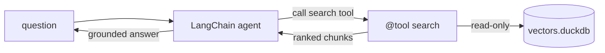

# LangChain guide

Wire a [LangChain](https://python.langchain.com/docs/introduction/) agent to
[`duckdb-vectors`](https://pypi.org/project/duckdb-vectors/) as a retrieval tool. The agent owns the model and the loop;
`duckdb-vectors` plugs in as one tool that opens a local, read-only index and
returns ranked chunks. The primary path imports the SDK and calls it in the
same process; the alternative reuses the stdio MCP server.

## What you will build

A LangChain tool named `search` that wraps `store.query` and returns the
grounding chunks for a question. The index is a local DuckDB file opened
read-only once at import; every tool call reuses it.



## Step 1 — install the pieces

`duckdb-vectors` carries the retrieval code; add LangChain and a model
provider of your choice:

```shell
$ pip install duckdb-vectors langchain langchain-openai
```

## Step 2 — build an index

Point the CLI at a folder of markdown to produce a single DuckDB file. Here we
index this project's own documentation:

```shell
$ duckdb-vectors index ./documentation --db vectors.duckdb --backend fastembed:minishlab/potion-multilingual-128M
```

The first run downloads the fastembed model; later runs reuse the cache.

## Step 3 — wrap store.query as a tool

The `@tool` decorator turns a plain function into a LangChain tool: the
function name becomes the tool name and the docstring becomes the description
the model reads. Open the store once at module scope and retrieve per call:

```python
from langchain_core.tools import tool

from duckdb_vectors import VectorStore

store = VectorStore(
    db_path="vectors.duckdb", backend="fastembed:minishlab/potion-multilingual-128M", read_only=True
)


@tool
def search(query: str, top_k: int = 5) -> str:
    """Search the duckdb-vectors documentation and return ranked chunks."""
    hits = store.query(query, top_k=top_k)
    return "\n\n".join(
        f"[{hit.chunk.source}] {hit.chunk.title}\n{hit.chunk.text}"
        for hit in hits
    )
```

Each `hit` is a `SearchResult`: `hit.score` is the fused rank and `hit.chunk`
carries `source`, `title`, and `text`.

## Step 4 — give the tool to an agent

Bind the tool to a model and let the agent decide when to retrieve:

```python
from langchain.agents import create_agent

agent = create_agent(model="openai:gpt-4o-mini", tools=[search])
result = agent.invoke(
    {"messages": [{"role": "user", "content": "how is a search answered?"}]}
)
print(result["messages"][-1].content)
```

The agent calls `search`, grounds its answer in the returned chunks, and
replies. Retrieval runs in-process against the local file — no external vector
service.

## Verify the tool on its own

Call the tool directly to confirm it retrieves before wiring it to a model:

```shell
$ python -c "from app import search; print(search.invoke({'query': 'how is a search answered?'}))"
```

The top chunk should come from the primitive's "how a search is answered"
section — the retrieval is working.

## The MCP alternative

Instead of importing the SDK, you can reach the same retrieval through the
stdio MCP server with
[langchain-mcp-adapters](https://github.com/langchain-ai/langchain-mcp-adapters).
Its `MultiServerMCPClient` spawns `duckdb-vectors mcp` and adapts its `search`
and `report` tools into LangChain tools:

```python
from langchain_mcp_adapters.client import MultiServerMCPClient

client = MultiServerMCPClient(
    {
        "duckdb-vectors": {
            "command": "duckdb-vectors",
            "args": ["mcp"],
            "transport": "stdio",
            "env": {"DUCKDB_VECTORS_DB_PATH": "vectors.duckdb"},
        }
    }
)
tools = await client.get_tools()
```

The MCP server resolves the index from the `DUCKDB_VECTORS_*` environment
variables and serves the same two read-only tools. See the
[Docker Agent guide](docker-agent-guide.md) for the canonical MCP wiring
reference.

## Where to go next

- The [LangGraph guide](langgraph-guide.md) turns the same `store.query` call
  into a retrieval node inside a graph.
- To ship a self-contained image carrying both the agent and a frozen index,
  follow the [containerized agent guide](containerized-agent-guide.md).
