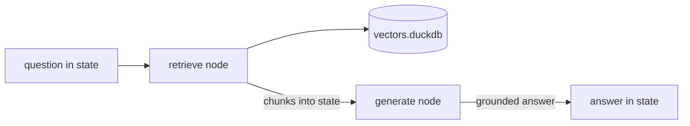

# LangGraph guide

Wire a [LangGraph](https://langchain-ai.github.io/langgraph/) graph to
[`duckdb-vectors`](https://pypi.org/project/duckdb-vectors/) as a retrieval node. The node calls `store.query` and writes
the chunks into graph state, so later nodes — a model call, a formatter — read
them from state. The primary path imports the SDK and calls it in the same
process; the alternative reuses the stdio MCP server as a tool node.

## What you will build

A two-node graph: a `retrieve` node that opens a local read-only index, runs
`store.query`, and stores the ranked chunks in state; and a `generate` node
that reads those chunks and asks the model to answer from them.



## Step 1 — install the pieces

`duckdb-vectors` carries the retrieval code; add LangGraph and a model
provider:

```shell
$ pip install duckdb-vectors langgraph langchain-openai
```

## Step 2 — build an index

Point the CLI at a folder of markdown to produce a single DuckDB file:

```shell
$ duckdb-vectors index ./documentation --db vectors.duckdb --backend fastembed:minishlab/potion-multilingual-128M
```

The first run downloads the fastembed model; later runs reuse the cache.

## Step 3 — the retrieval node

Open the store once at module scope. The node reads the question from state,
retrieves chunks, and writes a joined context string back into state:

```python
from typing import TypedDict

from langchain.chat_models import init_chat_model
from langgraph.graph import START, StateGraph

from duckdb_vectors import VectorStore

store = VectorStore(
    db_path="vectors.duckdb", backend="fastembed:minishlab/potion-multilingual-128M"
)
model = init_chat_model("openai:gpt-4o-mini")


class State(TypedDict):
    question: str
    context: str
    answer: str


def retrieve(state: State) -> dict:
    hits = store.query(state["question"], top_k=5)
    context = "\n\n".join(
        f"[{hit.chunk.source}] {hit.chunk.text}" for hit in hits
    )
    return {"context": context}
```

Each `hit` is a `SearchResult`: `hit.score` is the fused rank and `hit.chunk`
carries `source`, `title`, and `text`.

## Step 4 — the generate node and the graph

The `generate` node reads the context from state and asks the model to answer.
Wire the two nodes in sequence:

```python
def generate(state: State) -> dict:
    prompt = (
        f"Answer using only this context:\n\n{state['context']}\n\n"
        f"Question: {state['question']}"
    )
    return {"answer": model.invoke(prompt).content}


builder = StateGraph(State)
builder.add_node("retrieve", retrieve)
builder.add_node("generate", generate)
builder.add_edge(START, "retrieve")
builder.add_edge("retrieve", "generate")
graph = builder.compile()

result = graph.invoke({"question": "how is a search answered?"})
print(result["answer"])
```

Retrieval runs in-process against the local file; the chunks flow through state
to the model — no external vector service.

## Verify the node on its own

Call the node with a minimal state to confirm it retrieves before compiling the
graph:

```shell
$ python -c "from app import retrieve; print(retrieve({'question': 'how is a search answered?'})['context'][:200])"
```

The context should open with a chunk from the primitive's "how a search is
answered" section — the retrieval is working.

## The MCP alternative

Instead of importing the SDK in the node, you can expose the stdio MCP server's
tools as a LangGraph tool node with
[langchain-mcp-adapters](https://github.com/langchain-ai/langchain-mcp-adapters).
Its `MultiServerMCPClient` spawns `duckdb-vectors mcp` and adapts the `search`
tool; drop the resulting tool into a `ToolNode`:

```python
from langchain_mcp_adapters.client import MultiServerMCPClient
from langgraph.prebuilt import ToolNode

client = MultiServerMCPClient(
    {
        "duckdb-vectors": {
            "command": "duckdb-vectors",
            "args": ["mcp"],
            "transport": "stdio",
            "env": {"DUCKDB_VECTORS_DB_PATH": "vectors.duckdb"},
        }
    }
)
tools = await client.get_tools()
tool_node = ToolNode(tools)
```

The MCP server resolves the index from the `DUCKDB_VECTORS_*` environment
variables and serves the same two read-only tools. See the
[Docker Agent guide](docker-agent-guide.md) for the canonical MCP wiring
reference.

## Where to go next

- The [LangChain guide](langchain-guide.md) wraps the same `store.query` call
  as a single `@tool` for a looping agent instead of a graph node.
- To ship a self-contained image carrying both the graph and a frozen index,
  follow the [containerized agent guide](containerized-agent-guide.md).
