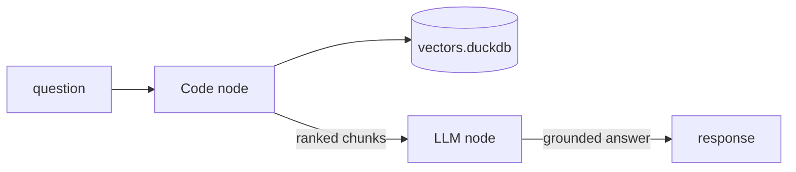

# n8n guide

Wire an [n8n](https://docs.n8n.io/) workflow to [`duckdb-vectors`](https://pypi.org/project/duckdb-vectors/) without
writing a service. n8n is low-code: a node runs the retrieval, and the rest of
the workflow routes the question and the answer. The primary path calls the
CLI or SDK in the same container as n8n; the alternative reaches the stdio MCP
server through an MCP Client node.

## What you will build

A workflow whose Code node opens a local read-only index, runs `store.query`
for the incoming question, and passes the ranked chunks to the next node — an
LLM node that answers from them. The index is a local DuckDB file baked into
the n8n container.



## Step 1 — put duckdb-vectors in the n8n container

The in-container path needs `duckdb-vectors` importable from the same runtime
n8n uses. Build an image from the n8n base and add the package plus a prebuilt
index:

```dockerfile
FROM n8nio/n8n
USER root
RUN pip install duckdb-vectors
COPY vectors.duckdb /data/vectors.duckdb
USER node
```

Build the index once on your workstation before copying it in:

```shell
$ duckdb-vectors index ./documentation --db vectors.duckdb --backend fastembed:minishlab/potion-multilingual-128M
```

## Step 2 — the Code node

n8n's Code node runs a snippet per item. Point it at the baked index, call
`store.query`, and return the chunks as the item's JSON so the next node reads
them:

```python
from duckdb_vectors import VectorStore

store = VectorStore(
    db_path="/data/vectors.duckdb", backend="fastembed:minishlab/potion-multilingual-128M"
)
question = _input.item.json["question"]
hits = store.query(question, top_k=5)
return [
    {
        "json": {
            "source": hit.chunk.source,
            "title": hit.chunk.title,
            "text": hit.chunk.text,
            "score": hit.score,
        }
    }
    for hit in hits
]
```

Each `hit` is a `SearchResult`: `hit.score` is the fused rank and `hit.chunk`
carries `source`, `title`, and `text`. If you prefer to shell out, an Execute
Command node running `duckdb-vectors search "$question" --db
/data/vectors.duckdb` returns the same chunks as JSON (the default output).

## Step 3 — ground the answer

Feed the retrieved chunks into an LLM node (the AI Agent or Basic LLM Chain
node) as context, and let the model answer the original question from them. The
retrieval ran in-process against the local file — no external vector service.

## Verify the retrieval

Confirm the CLI resolves the baked index from inside the container before
wiring the workflow:

```shell
$ docker exec -it n8n duckdb-vectors report --db /data/vectors.duckdb
```

The report prints the backend, dimensions, chunk count, and sources — proof the
index is readable in the n8n runtime.

## The MCP alternative

Instead of calling the SDK in a node, you can reach the same retrieval through
the stdio MCP server. n8n's built-in MCP Client Tool node connects over an
SSE/HTTP endpoint, so put `duckdb-vectors mcp` behind an HTTP bridge, or use a
community MCP node that spawns a local `command` / `args` subprocess and point
it at:

```text
command: duckdb-vectors
args: ["mcp"]
env:  DUCKDB_VECTORS_DB_PATH=/data/vectors.duckdb
```

Either way the server resolves the index from the `DUCKDB_VECTORS_*`
environment variables and serves the same two read-only tools, `search` and
`report`. See the [Docker Agent guide](docker-agent-guide.md) for the canonical
MCP wiring reference.

## Where to go next

- The [LangChain guide](langchain-guide.md) wraps the same `store.query` call
  as a code-first tool for a looping agent.
- To ship a self-contained image carrying both an agent and a frozen index,
  follow the [containerized agent guide](containerized-agent-guide.md).
