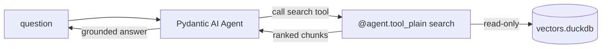

# Pydantic AI guide

Wire a [Pydantic AI](https://ai.pydantic.dev/) agent to `duckdb-vectors` as a
retrieval tool. The fit is natural: both sit on pydantic, so the chunks
`store.query` returns are already pydantic models and need no reshaping. The
primary path registers a tool that imports the SDK in the same process; the
alternative reuses the stdio MCP server as a toolset.

## What you will build {#what}

A Pydantic AI tool named `search` that wraps `store.query` and returns the
grounding chunks. The `@agent.tool_plain` decorator registers a plain function
(one that needs nothing from the run context) as a tool. The index is a local
DuckDB file opened read-only once at import.



## Step 1 — install the pieces {#install}

`duckdb-vectors` carries the retrieval code; add Pydantic AI:

```shell
$ pip install duckdb-vectors pydantic-ai
```

## Step 2 — build an index {#index}

Point the CLI at a folder of markdown to produce a single DuckDB file:

```shell
$ duckdb-vectors index ./documentation --db vectors.duckdb --backend local
```

The first run downloads the fastembed model; later runs reuse the cache.

## Step 3 — register store.query as a tool {#tool}

Create an `Agent`, then register the tool with `@agent.tool_plain`. The
docstring's `Args` section describes each argument to the model. Open the store
once at module scope and retrieve per call:

```python
from pydantic_ai import Agent

from duckdb_vectors import VectorStore

store = VectorStore(
    db_path="vectors.duckdb", backend="local", read_only=True
)
agent = Agent("openai:gpt-4o-mini")


@agent.tool_plain
def search(query: str, top_k: int = 5) -> list[dict]:
    """Search the duckdb-vectors documentation for a question.

    Args:
        query: The question to search for.
        top_k: How many chunks to return.
    """
    hits = store.query(query, top_k=top_k)
    return [
        {
            "source": hit.chunk.source,
            "title": hit.chunk.title,
            "text": hit.chunk.text,
            "score": hit.score,
        }
        for hit in hits
    ]
```

Each `hit` is a `SearchResult`: `hit.score` is the fused rank and `hit.chunk`
carries `source`, `title`, and `text` — all pydantic fields, so the returned
dicts round-trip without reshaping.

## Step 4 — run the agent {#run}

Ask a question; the agent calls `search`, grounds its answer in the chunks, and
replies:

```python
result = agent.run_sync("how is a search answered?")
print(result.output)
```

Retrieval runs in-process against the local file — no external vector service.

## Verify the tool on its own {#verify}

Call the underlying function directly to confirm it retrieves before running
the agent:

```shell
$ python -c "from app import search; print(search('how is a search answered?'))"
```

The top chunk should come from the primitive's "how a search is answered"
section — the retrieval is working.

## The MCP alternative {#mcp}

Instead of registering a tool that imports the SDK, you can reach the same
retrieval through the stdio MCP server. Pydantic AI's `MCPServerStdio` toolset
spawns `duckdb-vectors mcp` and surfaces its `search` and `report` tools; pass
it to the agent via `toolsets`:

```python
from pydantic_ai import Agent
from pydantic_ai.mcp import MCPServerStdio

server = MCPServerStdio(
    command="duckdb-vectors",
    args=["mcp"],
    env={"DUCKDB_VECTORS_DB_PATH": "vectors.duckdb"},
)
agent = Agent("openai:gpt-4o-mini", toolsets=[server])
```

The MCP server resolves the index from the `DUCKDB_VECTORS_*` environment
variables and serves the same two read-only tools. See the
[Docker Agent guide](docker-agent-guide.md) for the canonical MCP wiring
reference.

## Where to go next {#next}

- The [LangChain guide](langchain-guide.md) wraps the same `store.query` call
  as a `@tool` for a LangChain agent.
- To ship a self-contained image carrying both the agent and a frozen index,
  follow the [containerized agent guide](containerized-agent-guide.md).
