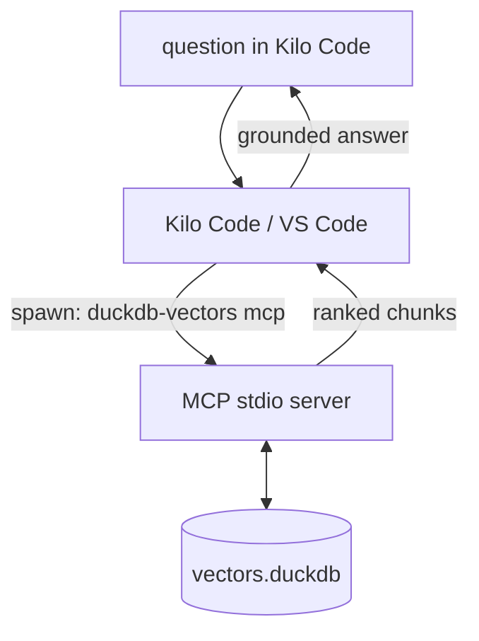

# Give Kilo Code a local knowledge base

Wire your own folder of documents into [Kilo Code](https://kilo.ai) — the agentic extension for VS Code — so the assistant can search it while you work, without sending anything to a cloud retrieval service. Kilo Code is an MCP client; `duckdb-vectors mcp` is an MCP server over stdio. Point one at the other and the assistant gains a read-only `search` tool over your indexed documents.

This is the __plug into an existing editor__ path. The index is a single DuckDB file on your disk, and the MCP server runs as a local subprocess Kilo Code spawns — no network on the query path.



## Step 1 — gather a folder of documents

Collect the documents you want Kilo Code to draw on into one folder. Indexing defaults to the composite chunker, which dispatches each file to the registered chunker claiming its MIME type: the markdown chunker splits markdown on headings and the PDF chunker reads PDFs directly, so both are first-class; convert other formats (HTML, office documents) to markdown first.

```text
knowledge/
  standards/python.md
  design/retrieval-notes.md
  runbooks/deploy.md
```

A local folder is all that is needed at index time — it can be a working copy, a git checkout, or a wiki export.

## Step 2 — note the folder and database paths

No manual install or indexing step is needed: the MCP server indexes the folder
on startup (incrementally, so an unchanged folder is near-instant on restart).
Just decide two __absolute__ paths — the folder of documents to index and the
DuckDB file to build — because Kilo Code spawns the subprocess with its own
working directory. For example `/abs/path/to/knowledge` and
`/abs/path/to/knowledge.duckdb`.

## Step 3 — add the MCP server to Kilo Code

Kilo Code reads MCP servers from a JSON config. Add a server launched with
[`uvx`](https://docs.astral.sh/uv/), which fetches and runs the latest published
[`duckdb-vectors`](https://pypi.org/project/duckdb-vectors/) on demand — no
manual `pip install`. Point it at your folder with `--index` and at the database
with `--db`; the server indexes on startup, then serves:

```json
{
  "mcpServers": {
    "knowledge": {
      "command": "uvx",
      "args": [
        "duckdb-vectors",
        "mcp",
        "--index",
        "/abs/path/to/knowledge",
        "--recursive",
        "--db",
        "/abs/path/to/knowledge.duckdb"
      ]
    }
  }
}
```

The first start downloads the package and the default local embedding model;
later starts reuse the `uv` and model caches, and the incremental index makes an
unchanged folder near-instant.

A few things to get right:

- __Use the `mcpServers` key__, not VS Code's native `servers` key. Kilo Code follows the Claude/Cursor convention; a snippet copied from VS Code's own MCP documentation will not register.
- __Scope.__ Put this in the project-level config so the knowledge base travels with the workspace, or in the global (user-level) config for a personal library shared across projects. Kilo Code's [MCP documentation](https://kilo.ai/docs/automate/mcp/using-in-kilo-code) gives the exact file name and location for each scope — check it, as the extension owns these paths.
- __`uvx` on PATH.__ The config assumes `uvx` is on the PATH the extension inherits. VS Code does not always inherit a shell PATH, so if the server fails to start, pin the absolute `uvx` path (for example `/absolute/path/to/uvx`), or install the package and point `command` at the absolute `duckdb-vectors` binary instead.

## Step 4 — confirm it works

After saving the config, Kilo Code starts the server and lists its tools. `duckdb-vectors mcp` registers two read-only tools:

- `search(query, top_k=5)` — hybrid semantic + exact-token search; returns ranked chunks (`chunk_id`, `text`, `source`, `title`, `score`).
- `report()` — the index's database path, backend, dimensions, chunk count, and sources.

Ask the assistant something your documents answer and confirm it calls `search` and grounds its reply in the returned chunks. You can also verify the server independently of Kilo Code:

```shell
$ DUCKDB_VECTORS_DB_PATH="$PWD/knowledge.duckdb" duckdb-vectors report
```

## Keeping the index fresh

The index is built on startup, not live; edits to the source folder are not picked up while the server runs. When the documents change, __restart (or reconnect) the server in Kilo Code__ — it re-indexes the folder on startup, and because indexing is incremental only the changed, added, and removed files are reconciled, so the refresh is fast. No separate indexing command is needed.
