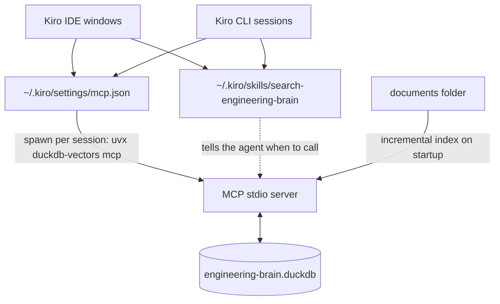

# Give Kiro a shared local knowledge base

Make a folder of your own documents — engineering conventions, workbooks, runbooks, past decisions — searchable from every [Kiro](https://kiro.dev) workspace, in both Kiro IDE and Kiro CLI, without sending anything to a cloud retrieval service. Two pieces work together:

- __An MCP server.__ One entry in Kiro's user-level `~/.kiro/settings/mcp.json` launches `duckdb-vectors mcp`, which gives the agent `search` and `report` tools over your indexed folder. Kiro IDE and Kiro CLI both read that file and merge it with each workspace's config, so one entry serves every workspace in both tools.
- __A skill.__ A global skill in `~/.kiro/skills/` tells the agent _when_ to reach for those tools — questions about how your team does things — so it searches the knowledge base instead of answering from general knowledge.

The index is a single DuckDB file on your disk. Each Kiro window or CLI session starts its own server process against that file; they share it safely.



## Step 1 — pick the folder and the database path

Choose the folder to index and where to keep the database. Indexing dispatches each file by type: Markdown is split on headings, PDFs are read per page with a local OCR fallback; convert other formats to Markdown first.

Keep the database outside any repository, so it never shows up in a `git status`. Next to the Kiro config works well:

```shell
$ mkdir -p ~/.kiro/knowledge
```

Note both paths as __absolute__ paths: MCP launch arguments are not shell-expanded, so `~` does not work in the config. This page uses `/Users/you/Public/engineering-brain/documentation` and `/Users/you/.kiro/knowledge/engineering-brain.duckdb`.

## Step 2 — add the MCP server to the user-level config

Open `~/.kiro/settings/mcp.json` (in Kiro IDE: command palette, __Kiro: Open user MCP config (JSON)__) and add an entry under `mcpServers`, next to any servers already there:

```json
{
  "mcpServers": {
    "engineering-brain": {
      "command": "uvx",
      "args": [
        "duckdb-vectors",
        "mcp",
        "--index",
        "/Users/you/Public/engineering-brain/documentation",
        "--recursive",
        "--db",
        "/Users/you/.kiro/knowledge/engineering-brain.duckdb"
      ],
      "disabled": false,
      "autoApprove": ["search", "report"]
    }
  }
}
```

[`uvx`](https://docs.astral.sh/uv/) fetches and runs the latest [`duckdb-vectors`](https://pypi.org/project/duckdb-vectors/) on demand, so there is no install step. With `--index`, the server indexes the folder on startup, then serves.

- __First start is slow, later starts are not.__ The first launch downloads the package, the default local embedding model, and two DuckDB extensions, then embeds the whole folder: 247 Markdown files (5,172 chunks) took 47 s on a MacBook Pro M1 (2021). Later starts re-index incrementally — an unchanged folder is re-read but nothing is re-embedded or rewritten — in about 2 s.
- __`autoApprove`__ lets the agent call `search` and `report` without a confirmation prompt. They never change the indexed documents. Opening the index can create an empty database file if none exists, and `search` embeds the query with the configured backend, which runs locally by default; only an opt-in backend such as `bedrock:titan` would send query text to a cloud provider. Leave `autoApprove` out to confirm each call.
- __Merge, do not replace.__ Keep your existing servers. A workspace's own `.kiro/settings/mcp.json` is merged on top of this file and wins for a server of the same name, so do not reuse the name `engineering-brain` in a workspace unless you mean to override it.
- __From the command line instead__, `kiro-cli mcp add --scope global` writes the same entry.

Saving the file reconnects the servers in Kiro IDE; new Kiro CLI sessions pick it up.

## Step 3 — add a skill that routes questions to it

The MCP tools are available everywhere, but the agent only reaches for them when it recognizes a question the knowledge base answers. A skill makes that explicit. Create `~/.kiro/skills/search-engineering-brain/SKILL.md`; the folder name must match the `name` field (lowercase letters, numbers, and hyphens), and the description must stay under 1,024 characters, because Kiro shows only the name and description until the skill activates:

```markdown
---
name: search-engineering-brain
description: >
  Ground an answer in the engineering-brain knowledge base — local engineering
  workbooks, runbooks, guides, methodologies, steering files, and templates —
  through the engineering-brain MCP server's search and report tools.
  Use this whenever a question is about how we do things rather than how things
  work in general: house conventions and naming rules, project or team
  practices, past decisions, workbooks and runbooks, review and release
  procedures, or "what do our docs say about X".
  Triggers on: "how do we usually", "our convention for", "what is our rule
  on", "check the engineering brain", "search our workbooks", "house style".
  Do NOT use for general programming knowledge the agent can answer directly,
  for code in the current repository, or for web search.
---

# Search the engineering brain

1. If unsure whether the corpus covers the topic, call the `engineering-brain`
   server's `report` tool and scan `sources`.
2. Call its `search` tool with the question in plain words plus any literal
   identifiers (acronyms, product names, flags).
3. Answer from the `text` of the top hits and cite each hit's `source`.
4. If the hits do not answer the question, say so rather than filling the gap.
```

Adapt the description to your own corpus: name the kinds of pages it holds and the phrases your team uses. Workspace skills in `.kiro/skills/` with the same name take precedence over this global one.

## Step 4 — confirm it works

In __Kiro IDE__, open the Kiro panel's MCP servers tab: `engineering-brain` should be connected with two tools, `search` and `report`. Startup and indexing messages appear in the Output tab under __Kiro - MCP Logs__. The skill appears under __Agent Steering & Skills__, and typing `/` in chat lists it.

In __Kiro CLI__, start a session and run `/mcp` to see the server's status and tools; in the V3 engine, `/config skills` lists the skill.

Then ask a question your documents answer, such as "how do we name AWS resources?", and check that the agent calls `search` and cites the returned `source` files.

You can also check the index without Kiro:

```shell
$ uvx duckdb-vectors report --db /Users/you/.kiro/knowledge/engineering-brain.duckdb
```

## Several sessions, one index

Each Kiro IDE window and each CLI session starts its own server process, all on the same database file. DuckDB lets one process hold a file at a time, so `duckdb-vectors` connects only when a call needs the file and, if another session holds it, waits up to `DUCKDB_VECTORS_LOCK_TIMEOUT` seconds (default 10) before giving up. Each search holds the file only for the call, and a startup re-index of an unchanged folder holds it for about 0.02 s. Measured with two sessions querying at once and a third re-indexing on startup: every query succeeded.

Each server loads the embedding model on its first `search`, about 2 s on the machine above, and keeps it loaded: later searches take about 45 ms through MCP, and `report` about 40 ms.

## Keeping the index fresh

The index is built when the server starts, not live. After editing the documents, restart or reconnect the `engineering-brain` server (Kiro IDE MCP tab, or start a new CLI session): it re-indexes incrementally, so only changed, added, and deleted files are processed.

## Troubleshooting

- __The server does not start.__ The config assumes `uvx` is on the PATH Kiro inherits; if it is not, set `command` to the absolute path (`which uvx`).
- __A custom Kiro CLI agent does not see the tools or the skill.__ The default agent loads both automatically. A custom agent needs `"includeMcpJson": true` to get servers from `mcp.json`, and a `skill://~/.kiro/skills/*/SKILL.md` entry in its `resources` to load global skills.
- __Untrusted workspace.__ Kiro CLI asks before every MCP tool call in a workspace you have not trusted, even with `autoApprove`; trust the workspace to stop the prompts.
- __"is locked by another process".__ Another session held the file for longer than the lock timeout, usually a first full index of a large folder. Wait for it to finish, or raise `DUCKDB_VECTORS_LOCK_TIMEOUT` in the server's `env`.
