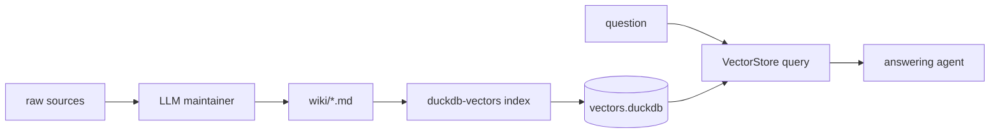

# Leverage an LLM-managed wiki into an agent

Here we turn an LLM-maintained wiki into an answering
machine with `duckdb-vectors`. This positions the component downstream of the
LLM Wiki pattern: the wiki is kept current by an LLM, and `duckdb-vectors`
makes it searchable at agent scale.

## Background: the LLM Wiki pattern

The [LLM Wiki pattern](https://gist.github.com/karpathy/442a6bf555914893e9891c11519de94f)
(Andrej Karpathy) describes three layers: immutable __raw sources__, an
LLM-maintained __wiki__ of interlinked markdown pages, and a __schema__ document
telling the LLM how to maintain it. Instead of re-deriving knowledge from raw
documents on every query, the LLM compiles knowledge once into the wiki and
keeps it current — cross-references, summaries, and contradictions are
maintained as sources arrive.

The pattern notes that at small scale an `index.md` catalog is enough to
navigate the wiki, but __as it grows you want proper search__ — a hybrid
BM25/vector engine the LLM can shell out to or call as a tool. That richer
variant (index plus log plus a real search tool over the pages) is where this
procedure applies: `duckdb-vectors` is that search tool.

## Where duckdb-vectors fits

The wiki is a folder of LLM-maintained markdown — exactly the chunkable input
`duckdb-vectors` is built for. You do not change how the wiki is produced; you
add a retrieval layer over its current pages so an agent can answer questions
by semantic search instead of reading the whole wiki each time.



## Step 1 — point at the wiki pages

Identify the directory the LLM maintains (the wiki layer, not the raw sources).
It is already markdown with headings, so no conversion is needed. If the wiki
adds YAML frontmatter (tags, dates), it is preserved in the chunk text and can
be queried later through metadata-scoped ranking SQL.

## Step 2 — index the wiki

Index the wiki folder. Headings give the chunker natural boundaries, and the
page breadcrumb becomes each chunk's title:

```shell
$ duckdb-vectors index ./wiki --recursive --backend local
$ duckdb-vectors report
```

## Step 3 — keep the index current

The wiki changes whenever the LLM ingests a new source. Re-index to pick up
changes; ETag reuse means only changed chunks are re-embedded and pages the
LLM deleted are pruned:

```shell
$ duckdb-vectors index ./wiki --recursive --backend local
```

Run this after each ingest (or on a schedule, or as a step in the wiki's own
maintenance loop). Because re-indexing is incremental, it is cheap to run
often, so the answering machine stays in step with the wiki.

## Step 4 — serve answers

Open the index read-only and retrieve per question, then let the agent answer
from the retrieved pages:

```python
from duckdb_vectors import VectorStore

store = VectorStore(db_path="vectors.duckdb", backend="local", read_only=True)
hits = store.query("what did we conclude about pricing?", top_k=5)
for hit in hits:
    print(hit.chunk.source, hit.chunk.title)
```

The result: the LLM keeps the wiki rich and current; `duckdb-vectors` turns
that living wiki into fast, grounded answers — a compounding knowledge base
with an answering machine on top.
