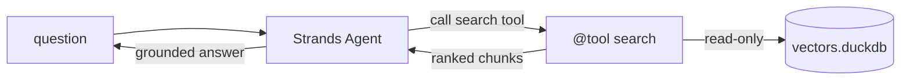

# Strands Agents guide

Wire a [Strands Agents](https://strandsagents.com/) agent to `duckdb-vectors`
as a retrieval tool. Strands is model-driven: you give an agent a model and a
set of tools, and the agent loop decides when to call them. The `@tool`
decorator turns a plain function into a tool, so wrapping `store.query` is one
small function. The primary path imports the SDK in the same process; the
alternative reuses the stdio MCP server.

## What you will build {#what}

A Strands `@tool` named `search` that wraps `store.query`. The docstring and
type hints become the tool spec the model reads. The index is a local DuckDB
file opened read-only once at import.



## Step 1 — install the pieces {#install}

`duckdb-vectors` carries the retrieval code; add the Strands SDK:

```shell
$ pip install duckdb-vectors strands-agents
```

## Step 2 — build an index {#index}

Point the CLI at a folder of markdown to produce a single DuckDB file:

```shell
$ duckdb-vectors index ./documentation --db vectors.duckdb --backend local
```

The first run downloads the fastembed model; later runs reuse the cache.

## Step 3 — wrap store.query as a tool {#tool}

Import `@tool` from `strands`. The function name becomes the tool name; the
docstring and type hints become the spec the model reads. Open the store once
at module scope and retrieve per call:

```python
from strands import Agent, tool

from duckdb_vectors import VectorStore

store = VectorStore(
    db_path="vectors.duckdb", backend="local", read_only=True
)


@tool
def search(query: str, top_k: int = 5) -> str:
    """Search the duckdb-vectors documentation and return ranked chunks.

    Args:
        query: The question to search for.
        top_k: How many chunks to return.
    """
    hits = store.query(query, top_k=top_k)
    return "\n\n".join(
        f"[{hit.chunk.source}] {hit.chunk.title}\n{hit.chunk.text}"
        for hit in hits
    )
```

Each `hit` is a `SearchResult`: `hit.score` is the fused rank and `hit.chunk`
carries `source`, `title`, and `text`.

## Step 4 — give the tool to an agent {#agent}

Pass the tool to an `Agent` and ask a question; the loop calls `search` and
grounds the answer:

```python
agent = Agent(tools=[search])
print(agent("how is a search answered?"))
```

Retrieval runs in-process against the local file — no external vector service.

## Verify the tool on its own {#verify}

Call the underlying function directly to confirm it retrieves before wiring it
to a model:

```shell
$ python -c "from app import search; print(search('how is a search answered?'))"
```

The top chunk should come from the primitive's "how a search is answered"
section — the retrieval is working.

## The MCP alternative {#mcp}

Instead of importing the SDK, you can reach the same retrieval through the
stdio MCP server. Strands' `MCPClient` spawns `duckdb-vectors mcp` over stdio
and surfaces its `search` and `report` tools to the agent:

```python
from mcp import StdioServerParameters, stdio_client
from strands import Agent
from strands.tools.mcp import MCPClient

mcp = MCPClient(
    lambda: stdio_client(
        StdioServerParameters(
            command="duckdb-vectors",
            args=["mcp"],
            env={"DUCKDB_VECTORS_DB_PATH": "vectors.duckdb"},
        )
    )
)
with mcp:
    agent = Agent(tools=mcp.list_tools_sync())
    print(agent("how is a search answered?"))
```

The MCP server resolves the index from the `DUCKDB_VECTORS_*` environment
variables and serves the same two read-only tools. See the
[Docker Agent guide](docker-agent-guide.md) for the canonical MCP wiring
reference.

## Where to go next {#next}

- The [AWS Bedrock AgentCore guide](aws-bedrock-agentcore-guide.md) deploys a
  Strands agent on the managed AgentCore runtime with a baked-in index.
- To ship a self-contained image carrying both the agent and a frozen index,
  follow the [containerized agent guide](containerized-agent-guide.md).
